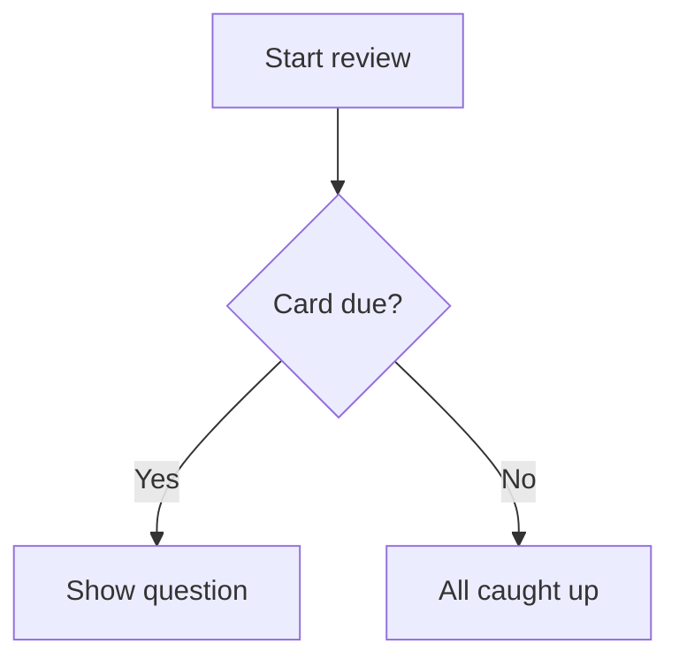

# Jak psát skvělé kartičky {#writing-cards number="3"}

::: lede
Kartička je otázka a odpověď. Všechno ostatní je nepovinné — a právě tam
začíná zábava. Pod obyčejným textovým polem se skrývá malý, přátelský
značkovací jazyk: mezery k doplnění, vysázená matematika, zvýrazněný
kód, diagramy, tabulky a slova, která se přečtou nahlas přesně tak, jak
chceš.
:::

::: inthischapter
- Zorientuj se v editoru kartičky
- Formátuj text, přidávej odkazy a doplňovačky (cloze)
- Dej na kartičku matematiku, kód, diagramy a tabulky
- Přidávej obrázky, které vypadají dobře ve světlém *i* tmavém režimu
- Řekni hlasu, co má říkat — a poznej čtyři místa, kde poslouchá
- Piš kartičky, které si tvoje paměť opravdu udrží
:::

## Editor kartičky v kostce {#editor}

:::: split
{.phone}

::: text
Každá kartička má dvě strany, **Otázku** a **Odpověď**, a každou stranu
upravuješ zvlášť. Strana má tři karty:

- **Text** — co napíšeš, s panelem formátování nad sebou.
- **Obrázek** — jeden obrázek z Fotek (nebo vložený do textu).
- **Audio** — zvukový soubor, třeba `.mp3`, `.m4a` nebo `.wav`.

Pod textovým polem najdeš [Nápověda formátování]{.ui} — kapesní verzi
této kapitoly, vždy na jedno klepnutí — a [Jazyk]{.ui} dané strany.

Strana nesmí být prázdná: otázka i odpověď potřebují text, obrázek nebo
zvuk, než se tlačítko [Uložit]{.ui} rozsvítí. Záleží i na tom, ze které
karty ukládáš — kapitola 4 vysvětluje, jak spojit text s obrázkem nebo
zvukem, aniž bys o jedno z nich přišel.
:::
::::

### Panel nástrojů

Značky si nikdy *nemusíš* pamatovat. Panel nad textovým polem je vloží
za tebe a obalí jimi to, co máš vybrané. Posouvá se do stran; zleva
doprava:

| Tlačítko | Vloží |
|---|---|
| Obrázek | obrázek strany, na místo kurzoru |
| **B** / *I* | `**tučně**` / `*kurzívou*` |
| `</>` | `` `kód v řádku` `` |
| *f(x)* / Σ | `$matematika v řádku$` / matematický blok `$$` |
| Zvuková vlna | `[zobrazeno]{vysloveno}` — mluvená nápověda |
| Cloze | `{{c1::…}}` — mezera k doplnění |
| Odkaz | `[popisek](https://…)` |
| Tabulka | tabulka se dvěma sloupci |
| Diagram | blok diagramu `mermaid` |
| Velký text | blok `::: hero` |

### Na jazyku záleží

Výběr [Jazyk]{.ui} říká JustFlip!, který hlas má danou stranu přečíst
nahlas, a každá strana má svůj — španělské slovo vepředu, jeho český
význam vzadu.

::: gotcha
#### Bez jazyka žádný hlas

Nová kartička začíná s jazykem nastaveným na **Žádné** a strana bez
jazyka se prostě *nepřečte* — ani tlačítkem reproduktoru, ani funkcí
Mluvit karty. Když kartička mlčí, zkontroluj nejdřív její jazyk.
:::

### Štítky a příznaky

Štítky píšeš do pole se štítky: klávesou Return, tlačítkem **+** nebo
čárkou proměníš text ve štítek. Vlož `slovesa, nepravidelná, A2` a
dostaneš rovnou tři štítky. Na velikosti písmen nezáleží a duplicity
zmizí. Barevný příznak kartičku zvýrazní, když balíček procházíš.

## Text, který vypadá správně {#text}

Text kartičky je Markdown, zjednodušený pro malé obrazovky. Tady je
všechno, co tvaruje obyčejný text:

:::: pair
```markdown
Mitochondrie jsou **elektrárnou**
*buňky*. Funkce se jmenuje
`atp_synthase()`.
```

::: {.card side="answer"}
Mitochondrie jsou **elektrárnou** *buňky*. Funkce se jmenuje
`atp_synthase()`.
:::
::::

- `**tučně**` a `*kurzívou*` — zdůraznění.
- `` `kód` `` — úryvek neproporcionálním písmem.
- `\*` — zpětné lomítko zobrazí další znak doslova, takže `\*bez
  kurzívy\*` si hvězdičky ponechá.
- **Prázdný řádek** začíná nový odstavec; jednoduchý zlom řádku zůstane,
  jak je.

::: note
#### Co schválně chybí

Kartičky jsou malé, takže pár zvyklostí z Markdownu neplatí. Řádek
začínající `# ` se zobrazí jako obyčejný text — mřížky zmizí, nadpisy na
kartičce nejsou. Značky seznamu jako `-` nebo `1.` se zobrazí přesně tak,
jak jsi je napsal, což je stejně obvykle to, co chceš.
:::

### Odkazy

`[návod](https://example.com)` zobrazí *návod* jako odkaz, na který jde
klepnout. Fungují webové odkazy (`https://`), e-mail (`mailto:`) a
telefon (`tel:`); jakýkoli jiný druh odkazu se zobrazí jako obyčejný
text.

## Doplň mezery {#cloze}

Kartička typu **cloze** (doplňovačka) skryje část věty. Otázka ukáže
mezeru; po otočení kartičky se chybějící slova objeví zvýrazněná. Je to
nejrychlejší způsob, jak z odstavce poznámek udělat něco, z čeho tě lze
vyzkoušet.

:::: pair
```markdown
Hlavní město Francie
je {{c1::Paříž}}.
```

::: {.card side="question"}
Hlavní město Francie je [[…]]{.blank}.
:::
::::

Za druhou dvojici dvojteček přidej **nápovědu**. Nápověda se objeví
uvnitř mezery a hlas ji vysloví místo slov „prázdné místo“:

:::: pair
```markdown
{{c1::Mitochondrie::organela}}
vyrábějí většinu ATP v buňce.
```

::: {.card side="question"}
[[organela]]{.blank} vyrábějí většinu ATP v buňce.
:::
::::

Po otočení kartičky se vrátí celá věta s vyznačenými odpověďmi —
[Mitochondrie]{.reveal} vyrábějí většinu ATP v buňce. Strana Odpověď je
u doplňovačky nepovinná. Cokoli tam napíšeš, se zobrazí pod odkrytou
větou jako poznámky navíc.

::: gotcha
#### Všechny mezery na kartičce se skrývají najednou

Mezery čísluj `c1`, `c2`, `c3`… — ale v JustFlip! se všechny mezery na
jedné kartičce skrývají a odkrývají *současně* a kartička se opakuje jako
jedna položka. Chceš být z každé mezery zkoušen zvlášť? Udělej pro každou
mezeru jednu kartičku.

Uživatelé Anki znají opačné chování: tam se z každého čísla stane
samostatná kartička. Přesně to se stane, když **importuješ** poznámku
typu cloze z Anki — rozdělí se na jednu kartičku pro každé číslo, takže
nepřijdeš o nic, co ses v Anki naučil.
:::

Pár detailů, které ušetří škrábání na hlavě:

- Počítají se jen správně zapsané mezery. `{{c0::x}}`, `{{c1::}}` nebo
  `{{not a cloze}}` se zobrazí doslova, i se složenými závorkami.
- Potřebuješ samotné závorky? Napiš `\{\{c1::…}}`.
- Uvnitř kódu a matematiky zůstane `{{c1::…}}` beze změny — doslova.

## Velké a na střed {#display}

Některé kartičky tvoří jediný znak: kana, kandži, chemická značka, název
akordu. Dej ho do bloku **hero** a vyplní celou kartičku:

:::: pair
```markdown
::: hero
あ
:::
```

::: {.card side="question" .hero}
あ
:::
::::

`::: center` dělá totéž bez změny velikosti — obsah se jen vycentruje.
Blok otevři `::: hero` nebo `::: center` na samostatném řádku a zavři ho
`:::`.

::: tip
#### Ať zdůrazňuje velikost

Poznámky drž *mimo* blok, aby zůstaly běžným textem, a uvnitř bloku hero
vynech tučné písmo i kurzívu. V téhle velikosti jen přidávají šum.
:::

## Matematika {#maths}

JustFlip! sází matematiku v syntaxi TeXu, zápisu, který používají
matematici po celém světě. Obal vzorec jednoduchými dolary, aby zůstal v
řádku, nebo ho dej mezi řádky `$$`, aby dostal vlastní vycentrovaný
řádek:

:::: pair
```markdown
Derivace:

$$
f'(x) = \lim_{h\to 0}\frac{f(x+h)-f(x)}{h}
$$
```

::: {.card side="answer"}
Derivace:

$$f'(x) = \lim_{h\to 0}\frac{f(x+h)-f(x)}{h}$$
:::
::::

{.shot width=78%}

Matematika v řádku funguje stejně: z `$E = mc^2$` se stane $E = mc^2$
přímo uprostřed věty. Jak zařídit, aby vzorec i *zněl* správně, když se
čte nahlas, se dozvíš v části [Řekni hlasu, co má říkat](#speech).

## Kód {#code}

Kód ohraď třemi zpětnými apostrofy a za úvodní ohrazení napiš název
jazyka. JustFlip! obarví klíčová slova, řetězce, komentáře, čísla a
typy:

:::: pair
````markdown
```swift
let answer = 6 * 7
// prints 42
print(answer)
```
````

::: {.card side="answer"}
```swift
let answer = 6 * 7
// prints 42
print(answer)
```
:::
::::

Rozpoznávané názvy jazyků: Swift, Python, JavaScript, TypeScript, Java,
Kotlin, C, C++, C#, Objective-C, Go, Rust, Ruby, PHP, SQL, Bash,
Smalltalk/Pharo, JSON a YAML. Neznámý nebo chybějící název ti pořád dá
čistý blok neproporcionálním písmem — jen bez barev. Text uvnitř bloku
kódu se zobrazí přesně tak, jak je napsaný; žádné značky se v něm
nepoužijí.

## Diagramy {#diagrams}

Blok kódu pojmenovaný `mermaid` se vůbec nezobrazí jako kód — JustFlip!
ho nakreslí. Podporované jsou vývojové diagramy a diagramy sekvencí,
stavů, tříd i vztahů mezi entitami.

:::: pair
````markdown

````

{.card-shot}
::::

::: tip
#### Diagramy do velikosti kartičky

Miř zhruba na osm boxů s krátkými popisky. Začni `graph TD` (shora
dolů); JustFlip! může vývojový diagram otočit na bok, když se tak na
kartičku vejde lépe. Kvůli detailům otevře tlačítko **Přiblížit**
diagram na celou obrazovku.
:::

## Tabulky {#tables}

Malá srovnání se nejlépe čtou jako tabulka. Nad ní nech prázdný řádek;
první řádek je záhlaví a zobrazí se tučně:

:::: pair
```markdown
| Čas | Tvar |
|---|---|
| Přítomný | I go |
| Minulý | I went |
| Předpřítomný | I have gone |
```

::: {.card side="answer"}
| Čas | Tvar |
|---|---|
| Přítomný | I go |
| Minulý | I went |
| Předpřítomný | I have gone |
:::
::::

Buňky přijímají stejné formátování jako zbytek kartičky — tučné písmo,
kód, matematiku. Chceš-li v buňce zobrazit `|`, napiš `\|`.

::: gotcha
#### Dva sloupce, pět řádků

Tabulka na kartičce má nejvýš **2 sloupce a 5 řádků** včetně záhlaví.
Co je navíc, se vynechá a označí výpustkou. Dvojtečky pro zarovnání jako
`|:---|---:|` jsou přijaty, ale sloupce jsou vždy zarovnané doleva. Větší
tabulka obvykle znamená, že by z kartičky mělo být kartiček víc.
:::

## Obrázky {#pictures}

Každá strana kartičky unese **jeden obrázek**. Přidej ho na kartě
Obrázek, nebo tlačítkem obrázku na panelu nástrojů, které do textu
vloží i značku:

```markdown
Který je to pták?

![attachment:0]
```

Značka `![attachment:0]` určuje, *kde* mezi textem obrázek bude. Značka,
za kterou žádný obrázek není, prostě nic nezobrazí.

Obrázek má také pole **popisu**. VoiceOver ho přečte lidem, kteří obrázek
nevidí, takže stojí za pár slov.

::: gotcha
#### Průhledné obrázky v tmavém režimu zmizí

Kartička vykreslí tvůj obrázek přesně tak, jak je, bez pozadí. Černé
čáry na průhledném pozadí vypadají na světlé kartičce skvěle a na tmavé
úplně zmizí. Diagramům, notovým zápisům a perokresbám dej před přidáním
plné bílé pozadí.
:::

Používej fotky a bitmapy (PNG, JPEG). Soubory SVG podporované nejsou.
Velké fotky nemusíš předem zmenšovat: JustFlip! při uložení zmenší
obrázek na 3 000 pixelů na delší straně, aby synchronizace přes iCloud
zůstala rychlá na všech tvých zařízeních. Víc o obrázcích, které dobře
fungují, najdeš v kapitole 4.

## Řekni hlasu, co má říkat {#speech}

JustFlip! umí kteroukoli kartičku přečíst nahlas hlasem pro jazyk dané
strany. Obvykle to zvládne správně. Když ne — zkratka, symbol, vzorec —
můžeš mu dát **mluvenou nápovědu**: složené závorky hned za něčím řeknou
hlasu, ať místo toho vysloví *tohle*.

:::: pair
```markdown
Zapni v [iOS]{aj ó es}
obnovu na pozadí.
```

::: {.card side="question" spoken="Zapni v aj ó es obnovu na pozadí."}
Zapni v iOS obnovu na pozadí.
:::
::::

Kartička pořád ukazuje *iOS*; hlas řekne „aj ó es“. Stejné pravidlo
funguje přesně na čtyřech místech:

| Kde | Napíšeš |
|---|---|
| Jakýkoli text, v hranatých závorkách | `[C♯ moll]{cis moll}` |
| Matematika v řádku | `$c^2${cé na druhou}` |
| Matematický blok — za uzavíracími `$$` | `$${V se rovná S krát p krát v}` |
| Obrázek | `![attachment:0]{červené jablko}` |

Bez nápovědy se text čte normálně, matematika se přečte ze zdrojového
zápisu a obrázky mlčí.

::: gotcha
#### Závorky za čímkoli jiným se zobrazí

Nápověda funguje jen na těch čtyřech místech. Za tučným písmem, kurzívou
nebo holým textem se závorky na kartičce zobrazí:

- `*F♯ dur*{fis dur}` → kartička ukáže *F♯ dur*{fis dur}
- `*[F♯ dur]{fis dur}*` → kartička ukáže *F♯ dur* a hlas řekne
  „fis dur“

Když si nejsi jistý, použij hranaté závorky. Formátování dej *mimo* ně.
:::

::: tip
#### Nápovědy pro to, co hlas plete

Nápovědy jsou pro křížky a béčka v hudbě, vzorce, zkratky a
romanizované slabiky — věci, nad kterými převod textu na řeč klopýtá.
Nemusíš opakovat to, co už je napsané. A pro celkově lepší hlasy si v
nastavení systému, v části **Zpřístupnění › Čtení a mluvení › Hlasy**,
stáhni vylepšený nebo prémiový hlas a pak ho v JustFlip! vyber v
**Nastavení › Řeč › Hlasy**.
:::

## Když je kartička moc dlouhá {#fitting}

JustFlip! se nejdřív snaží vměstnat na kartičku všechno. Když se text
nevejde, mírně se zmenší, až na 80 % normální velikosti. Když se ani pak
nevejde, text se usekne za posledním celým řádkem a spodek kartičky
vybledne.

Nic se ale neztratí. Tlačítko **•••** dole na kartičce otevře celý obsah
dané strany v panelu. Na kartičce, jejíž diagram nebo obrázek se vejde,
je na stejném místě místo toho **Přiblížit**, které obrázek otevře na
celou obrazovku.

Je to záchranná síť, ne styl psaní. Kartička, kterou nepřečteš na první
pohled, jsou obvykle dvě nebo tři kartičky, které se tváří jako jedna.

## Kartičky, které si paměť udrží {#good-cards}

Formátování dělá kartičku příjemnou. Tyhle návyky zařídí, aby
*fungovala*:

1. **Jeden fakt na kartičku.** „Jaké jsou tři složky státní moci?“ je
   jedna kartička, která polovinu času selže. Tři kartičky, jedna na
   každou složku, uspějí každá sama za sebe.
2. **Ptej se přesně.** Otázka, na kterou jsou dvě správné odpovědi, tě
   nenaučí ani jednu. Přidávej kontext — nebo nápovědu v doplňovačce —
   dokud nesedí jen jedna odpověď.
3. **Používej vlastní slova.** Přeformulování je první opakování, a to
   zadarmo.
4. **Přidej obrázek nebo zvuk**, kdykoli ta věc *je* vizuální nebo
   slyšitelná: pták, akord, výslovnost.
5. **Texty otázek v balíčku drž jedinečné.**

::: gotcha
#### Dvě kartičky, jedna otázka

Když importuješ soubor s balíčkem (kapitola 5), kartička, jejíž text
otázky odpovídá kartičce, která už v balíčku je, tu kartičku
*aktualizuje*, místo aby přidala novou. Díky tomu je opakovaný import
balíčku bezpečný. Znamená to ale také, že dvě kartičky se stejným textem
otázky — třeba „Pojmenuj tento tón.“ — se slijí v jednu. Společné zadání
dej raději do názvu balíčku, nebo u kartiček jen s obrázkem nech text
otázky prázdný.
:::

## Tahák {#cheat-sheet .cheatsheet}

| Napíšeš | Dostaneš |
|---|---|
| `**tučně**` · `*kurzívou*` | **tučně** · *kurzívou* |
| `` `kód` `` | úryvek neproporcionálním písmem |
| `\*` | doslovnou `*` |
| `[popisek](https://…)` | odkaz (`https`, `mailto`, `tel`) |
| `{{c1::odpověď}}` | mezeru, odkrytou po otočení |
| `{{c1::odpověď::nápověda}}` | mezeru s nápovědou |
| `::: hero` … `:::` | velmi velký obsah na střed |
| `::: center` … `:::` | obsah na střed |
| `$x^2$` | matematiku v řádku |
| `$$` … `$$` | vycentrovaný matematický blok |
| ```` ```swift ```` … ```` ``` ```` | zvýrazněný kód |
| ```` ```mermaid ```` … ```` ``` ```` | diagram |
| `| A | B |` + `|---|---|` | tabulku, max. 2 × 5 |
| `![attachment:0]` | obrázek strany, sem |
| `[zobrazeno]{vysloveno}` | nahlas řekne něco jiného |
| `$x^2${x na druhou}` | vyslovený vzorec |
| `![attachment:0]{červené jablko}` | vyslovený obrázek |
