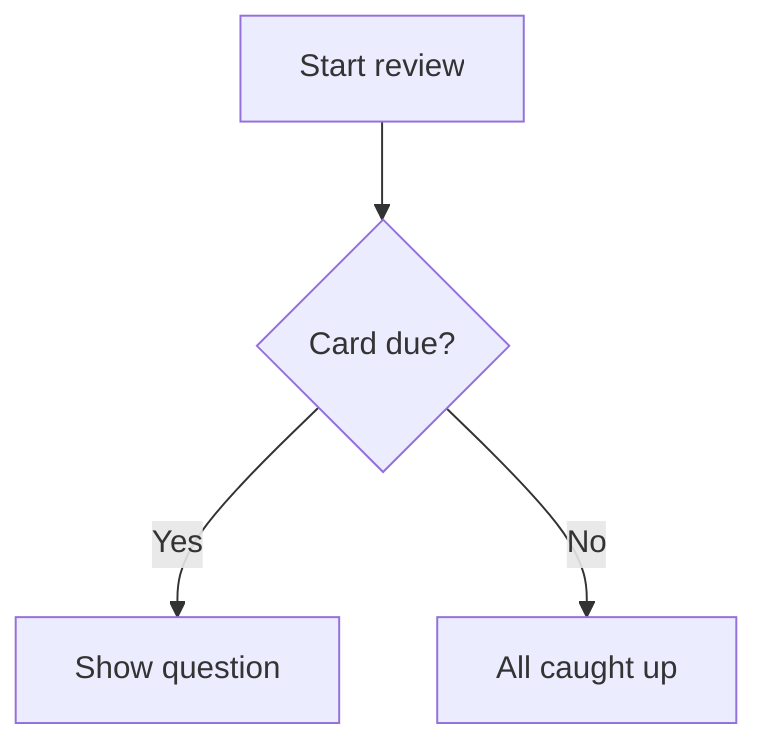

# Gute Karten schreiben {#writing-cards number="3"}

::: lede
Eine Karte ist eine Frage und eine Antwort. Alles andere ist optional —
und genau da fängt der Spaß an. Unter dem schlichten Textfeld steckt
eine kleine, freundliche Auszeichnungssprache: Lücken zum Ausfüllen,
gesetzte Mathematik, hervorgehobener Code, Diagramme, Tabellen und
Wörter, die genau so vorgelesen werden, wie du es willst.
:::

::: inthischapter
- Dich im Karteneditor zurechtfinden
- Text gestalten, Links und Lückentextkarten hinzufügen
- Mathematik, Code, Diagramme und Tabellen auf eine Karte bringen
- Bilder hinzufügen, die im hellen *und* dunklen Modus gut aussehen
- Der Stimme sagen, was sie sprechen soll — und die vier Stellen kennen, an denen sie hinhört
- Karten schreiben, die dein Gedächtnis wirklich behält
:::

## Der Karteneditor auf einen Blick {#editor}

:::: split
{.phone}

::: text
Jede Karte hat zwei Seiten, **Frage** und **Antwort**, und jede Seite
wird für sich bearbeitet. Eine Seite hat drei Tabs:

- **Text** — was du tippst, mit der Formatierungsleiste darüber.
- **Bild** — ein Bild aus Fotos (oder in den Text eingefügt).
- **Audio** — eine Audiodatei, etwa `.mp3`, `.m4a` oder `.wav`.

Unter dem Textfeld findest du die [Formatierungshilfe]{.ui} — eine
Taschenausgabe dieses Kapitels, immer nur einen Tipp entfernt — und die
[Sprache]{.ui} der Seite.

Eine Seite darf nicht leer sein: Frage und Antwort brauchen beide Text,
ein Bild oder einen Ton, bevor [Speichern]{.ui} aktiv wird. Auch der Tab,
aus dem du speicherst, spielt eine Rolle — Kapitel 4 erklärt, wie du
Text mit einem Bild oder Ton kombinierst, ohne eines davon zu verlieren.
:::
::::

### Die Formatierungsleiste

Die Auszeichnung musst du dir *nie* merken. Die Leiste über dem Textfeld
fügt sie für dich ein, rund um das, was du gerade markiert hast. Sie
lässt sich seitlich scrollen; von links nach rechts:

| Taste | Fügt ein |
|---|---|
| Bild | das Bild der Seite, an der Cursorposition |
| **B** / *I* | `**bold**` / `*italic*` |
| `</>` | `` `inline code` `` |
| *f(x)* / Σ | `$inline maths$` / einen `$$`-Mathematikblock |
| Wellenform | `[shown]{spoken}` — einen gesprochenen Hinweis |
| Lückentext | `{{c1::…}}` — eine Lücke zum Ausfüllen |
| Link | `[label](https://…)` |
| Tabelle | eine zweispaltige Tabelle |
| Diagramm | einen `mermaid`-Diagrammblock |
| Großer Text | einen `::: hero`-Block |

### Die Sprache zählt

Die Auswahl [Sprache]{.ui} sagt JustFlip!, welche Stimme diese Seite
vorlesen soll, und jede Seite hat ihre eigene — ein spanisches Wort
vorne, seine deutsche Bedeutung hinten.

::: gotcha
#### Keine Sprache, keine Stimme

Eine neue Karte beginnt mit der Sprache **Keine**, und eine Seite ohne
Sprache wird schlicht *nicht vorgelesen* — weder über die
Lautsprechertaste noch über Karten vorlesen. Bleibt eine Karte stumm,
prüf zuerst ihre Sprache.
:::

### Tags und Markierungen

Tags tippst du in ein Chip-Feld: Mit dem Zeilenschalter, der Taste
**+** oder einem Komma wird aus dem Text ein Tag. Füge `verbs,
irregular, A2` ein, und du bekommst auf einen Schlag drei Chips. Groß-
und Kleinschreibung spielen keine Rolle, Duplikate werden verworfen. Eine
Farbmarkierung hebt eine Karte hervor, wenn du einen Stapel durchsiehst.

## Text, der richtig aussieht {#text}

Kartentext ist Markdown, vereinfacht für kleine Bildschirme. Das hier
ist alles, was einfachen Text gestaltet:

:::: pair
```markdown
Mitochondria are the **powerhouse**
of the *cell*. The function is
`atp_synthase()`.
```

::: {.card side="answer"}
Mitochondria are the **powerhouse** of the *cell*. The function is
`atp_synthase()`.
:::
::::

- `**bold**` und `*italic*` — Hervorhebung.
- `` `code` `` — ein Schnipsel in Festbreitenschrift.
- `\*` — ein Backslash zeigt das nächste Zeichen wörtlich, sodass `\*not
  italic\*` seine Sternchen behält.
- Eine **Leerzeile** beginnt einen neuen Absatz; ein einfacher
  Zeilenumbruch bleibt so, wie er ist.

::: note
#### Was mit Absicht fehlt

Karten sind klein, deshalb gelten ein paar Markdown-Gewohnheiten nicht.
Eine Zeile, die mit `# ` beginnt, wird als einfacher Text angezeigt —
die Rauten fallen weg, Überschriften gibt es auf einer Karte nicht.
Listenzeichen wie `-` oder `1.` erscheinen genau so, wie du sie getippt
hast, und das ist meistens ohnehin, was du willst.
:::

### Links

`[the guide](https://example.com)` zeigt *the guide* als antippbaren Link.
Web- (`https://`), E-Mail- (`mailto:`) und Telefonlinks (`tel:`)
funktionieren; jede andere Art von Link wird als einfacher Text
angezeigt.

## Lücken füllen {#cloze}

Eine **Lückentextkarte** verbirgt einen Teil eines Satzes. Die Frage
zeigt eine Lücke; beim Umdrehen erscheinen die fehlenden Wörter,
hervorgehoben. So machst du am schnellsten aus einem Absatz Notizen
etwas, worin du dich abfragen lassen kannst.

:::: pair
```markdown
The capital of France
is {{c1::Paris}}.
```

::: {.card side="question"}
The capital of France is [[…]]{.blank}.
:::
::::

Einen **Hinweis** fügst du nach einem zweiten Doppelpunktpaar hinzu. Der
Hinweis erscheint in der Lücke, und die Stimme sagt ihn anstelle des
Wortes „Lücke“:

:::: pair
```markdown
{{c1::Mitochondria::organelle}}
produce most of the cell's ATP.
```

::: {.card side="question"}
[[organelle]]{.blank} produce most of the cell's ATP.
:::
::::

Beim Umdrehen kommt der ganze Satz mit markierten Antworten zurück —
[Mitochondria]{.reveal} produce most of the cell's ATP. Die
Antwortseite einer Lückentextkarte ist optional. Was du dort schreibst,
erscheint unter dem aufgedeckten Satz als zusätzliche Notiz.

::: gotcha
#### Alle Lücken einer Karte verschwinden gemeinsam

Nummeriere deine Lücken `c1`, `c2`, `c3`… — aber in JustFlip! wird jede
Lücke auf einer Karte *gleichzeitig* verborgen und aufgedeckt, und die
Karte wird als ein einziges Element wiederholt. Willst du zu jeder Lücke
einzeln abgefragt werden? Mach eine Karte pro Lücke.

Wer Anki nutzt, kennt das andere Verhalten: Dort wird aus jeder Nummer
eine eigene Karte. Genau das passiert, wenn du eine Anki-Lückentextnotiz
**importierst** — sie wird in eine Karte pro Nummer aufgeteilt, sodass
nichts verloren geht, was du in Anki gelernt hast.
:::

Ein paar Details, die dir Kopfzerbrechen ersparen:

- Nur korrekt geschriebene Lücken zählen. `{{c0::x}}`, `{{c1::}}` oder
  `{{not a cloze}}` werden wörtlich angezeigt, samt geschweifter
  Klammern.
- Du brauchst die Klammern selbst? Schreib `\{\{c1::…}}`.
- In Code und Mathematik bleibt `{{c1::…}}` unangetastet — es bleibt
  wörtlich stehen.

## Groß und zentriert {#display}

Manche Karten bestehen aus einem einzigen Zeichen: ein Kana, ein Kanji,
ein chemisches Symbol, ein Akkordname. Steck es in einen
**hero**-Block, und es füllt die Karte:

:::: pair
```markdown
::: hero
あ
:::
```

::: {.card side="question" .hero}
あ
:::
::::

`::: center` macht dasselbe ohne Größenänderung — der Inhalt wird
einfach zentriert. Öffne den Block mit `::: hero` oder `::: center` in
einer eigenen Zeile und schließ ihn mit `:::`.

::: tip
#### Lass die Größe für Betonung sorgen

Halte Notizen *außerhalb* des Blocks, damit sie normaler Text bleiben,
und verzichte in einem hero-Block auf Fett oder Kursiv. In dieser Größe
stören sie nur.
:::

## Mathematik {#maths}

JustFlip! setzt Mathematik mit TeX-Syntax, der Schreibweise, die
Mathematikerinnen und Mathematiker überall verwenden. Setz eine Formel
zwischen einfache Dollarzeichen, damit sie in der Zeile bleibt, oder
zwischen `$$`-Zeilen, damit sie eine eigene zentrierte Zeile bekommt:

:::: pair
```markdown
The derivative:

$$
f'(x) = \lim_{h\to 0}\frac{f(x+h)-f(x)}{h}
$$
```

::: {.card side="answer"}
The derivative:

$$f'(x) = \lim_{h\to 0}\frac{f(x+h)-f(x)}{h}$$
:::
::::

{.shot width=78%}

Mathematik in der Zeile funktioniert genauso: Aus `$E = mc^2$` wird
$E = mc^2$, mitten im Satz. Wie eine Formel beim Vorlesen auch richtig
*klingt*, erfährst du unter [Der Stimme sagen, was sie sprechen
soll](#speech).

## Code {#code}

Umschließe Code mit drei Backticks und nenne die Sprache nach dem
öffnenden Zaun. JustFlip! färbt Schlüsselwörter, Zeichenketten,
Kommentare, Zahlen und Typen ein:

:::: pair
````markdown
```swift
let answer = 6 * 7
// prints 42
print(answer)
```
````

::: {.card side="answer"}
```swift
let answer = 6 * 7
// prints 42
print(answer)
```
:::
::::

Erkannte Sprachnamen: Swift, Python, JavaScript, TypeScript, Java,
Kotlin, C, C++, C#, Objective-C, Go, Rust, Ruby, PHP, SQL, Bash,
Smalltalk/Pharo, JSON und YAML. Ein unbekannter oder fehlender Name
ergibt trotzdem einen sauberen Block in Festbreitenschrift — nur ohne
Farben. Text in einem Codeblock wird genau so angezeigt, wie er
geschrieben ist; Auszeichnung wird dort nicht angewendet.

## Diagramme {#diagrams}

Ein Codeblock mit dem Namen `mermaid` wird gar nicht als Code angezeigt
— JustFlip! zeichnet ihn. Fluss-, Sequenz-, Zustands-, Klassen- und
Entity-Relationship-Diagramme werden alle unterstützt.

:::: pair
````markdown

````

{.card-shot}
::::

::: tip
#### Diagramme in Kartengröße

Ziel auf etwa acht Kästen mit kurzen Beschriftungen. Beginne mit
`graph TD` (von oben nach unten); JustFlip! legt ein Flussdiagramm unter
Umständen auf die Seite, wenn es so besser auf die Karte passt. Für
Details öffnet die Taste **Zoomen** das Diagramm im Vollbild.
:::

## Tabellen {#tables}

Kleine Vergleiche liest man am besten als Tabelle. Lass darüber eine
Leerzeile; die erste Zeile ist die Kopfzeile und wird fett dargestellt:

:::: pair
```markdown
| Tense | Form |
|---|---|
| Present | I go |
| Past | I went |
| Perfect | I have gone |
```

::: {.card side="answer"}
| Tense | Form |
|---|---|
| Present | I go |
| Past | I went |
| Perfect | I have gone |
:::
::::

Zellen akzeptieren dieselbe Formatierung wie der Rest der Karte — Fett,
Code, Mathematik. Um ein `|` in einer Zelle zu zeigen, schreib `\|`.

::: gotcha
#### Zwei Spalten, fünf Zeilen

Eine Kartentabelle hat höchstens **2 Spalten und 5 Zeilen**, die
Kopfzeile eingerechnet. Alles darüber hinaus wird weggelassen und mit
Auslassungspunkten markiert. Ausrichtungs-Doppelpunkte wie `|:---|---:|`
werden akzeptiert, Spalten sind aber immer linksbündig. Eine größere
Tabelle ist meist ein Zeichen, dass die Karte eigentlich mehrere Karten
sein will.
:::

## Bilder {#pictures}

Jede Seite einer Karte enthält **ein Bild**. Füge es im Tab „Bild“ hinzu
oder mit der Bildtaste in der Formatierungsleiste, die außerdem eine
Markierung in den Text einfügt:

```markdown
Which bird is this?

![attachment:0]
```

Die Markierung, `![attachment:0]`, bestimmt, *wo* das Bild zwischen dem
Text steht. Eine Markierung ohne Bild dahinter zeigt einfach nichts an.

Das Bild hat außerdem ein Feld für eine **Beschreibung**. VoiceOver
liest sie Menschen vor, die das Bild nicht sehen können – ein paar Worte
lohnen sich also.

::: gotcha
#### Transparente Bilder verschwinden im dunklen Modus

Eine Karte zeichnet dein Bild genau so, wie es ist, ohne Hintergrund
dahinter. Schwarze Linien auf transparentem Hintergrund sehen auf einer
hellen Karte perfekt aus und verschwinden auf einer dunklen komplett.
Gib Diagrammen, Notenschrift und Strichzeichnungen einen deckend weißen
Hintergrund, bevor du sie hinzufügst.
:::

Verwende Fotos und Rastergrafiken (PNG, JPEG). SVG-Dateien werden nicht
unterstützt. Große Fotos musst du nicht vorher verkleinern: JustFlip!
skaliert ein Bild beim Speichern auf 3.000 Pixel an der langen Seite
herunter, damit die iCloud-Synchronisierung auf all deinen Geräten
schnell bleibt. Mehr zu Bildern, die gut funktionieren, steht in
Kapitel 4.

## Der Stimme sagen, was sie sprechen soll {#speech}

JustFlip! kann jede Karte vorlesen, mit der Stimme für die Sprache der
jeweiligen Seite. Meist klappt das gut. Wenn nicht — bei einer
Abkürzung, einem Symbol, einer Formel —, kannst du ihr einen
**gesprochenen Hinweis** geben: Geschweifte Klammern direkt nach etwas
sagen der Stimme, dass sie stattdessen *das hier* sprechen soll.

:::: pair
```markdown
Enable [iOS]{eye oh ess}
background refresh.
```

::: {.card side="question" spoken="Enable eye oh ess background refresh."}
Enable iOS background refresh.
:::
::::

Die Karte zeigt weiterhin *iOS*; die Stimme sagt „eye oh ess“. Dieselbe
Regel funktioniert an genau vier Stellen:

| Wo | Du schreibst |
|---|---|
| Beliebiger Text, in eckigen Klammern | `[C♯ minor]{C sharp minor}` |
| Mathematik in der Zeile | `$c^2${c squared}` |
| Ein Mathematikblock — nach dem schließenden `$$` | `$${V equals S p v}` |
| Ein Bild | `![attachment:0]{a red apple}` |

Ohne Hinweis wird Text normal vorgelesen, Mathematik aus ihrem Quelltext
vorgelesen, und Bilder bleiben stumm.

::: gotcha
#### Klammern nach allem anderen werden angezeigt

Ein Hinweis funktioniert nur an diesen vier Stellen. Nach fettem,
kursivem oder einfachem Text werden die Klammern auf der Karte
angezeigt:

- `*F♯ major*{F sharp major}` → die Karte zeigt *F♯ major*{F sharp major}
- `*[F♯ major]{F sharp major}*` → die Karte zeigt *F♯ major*, und die
  Stimme sagt „F sharp major“

Im Zweifel nimm eckige Klammern. Setz jede Formatierung *außerhalb*
davon.
:::

::: tip
#### Hinweise für das, was die Stimme falsch macht

Hinweise sind für Kreuze und Bs in der Musik, Formeln, Abkürzungen und
romanisierte Silben gedacht — Dinge, über die die Sprachausgabe stolpert.
Was schon dasteht, musst du nicht wiederholen. Und für insgesamt bessere
Stimmen lade in den Systemeinstellungen unter **Bedienungshilfen ›
Vorlesen & Sprechen › Stimmen** eine erweiterte oder Premium-Stimme
herunter und wähle sie dann in JustFlip! unter **Einstellungen ›
Sprachausgabe › Stimmen**.
:::

## Wenn eine Karte zu lang ist {#fitting}

JustFlip! versucht zuerst, alles auf die Karte zu bringen. Passt der Text
nicht, wird er etwas kleiner, bis auf 80 % der normalen Größe. Passt er
immer noch nicht, wird er an der letzten vollständigen Zeile
abgeschnitten, und der untere Rand der Karte blendet aus.

Verloren geht dabei aber nichts. Die Taste **•••** unten auf einer Karte
öffnet den vollständigen Inhalt dieser Seite in einem Blatt. Auf einer
Karte, deren Diagramm oder Bild passt, sitzt an derselben Stelle
stattdessen **Zoomen**, das das Bild im Vollbild öffnet.

Das ist ein Sicherheitsnetz, kein Schreibstil. Eine Karte, die du nicht
auf einen Blick lesen kannst, sind meist zwei oder drei Karten, die sich
als eine ausgeben.

## Karten, die dein Gedächtnis behält {#good-cards}

Formatierung macht eine Karte angenehm. Diese Gewohnheiten sorgen dafür,
dass sie *funktioniert*:

1. **Eine Tatsache pro Karte.** „Welche drei Staatsgewalten gibt es?“
   ist eine Karte, die in der Hälfte der Fälle scheitert. Drei Karten,
   eine pro Gewalt, gelingen jede für sich.
2. **Frag präzise.** Eine Frage, auf die zwei Antworten passen, bringt
   dir keine von beiden bei. Ergänze Kontext — oder einen
   Lückentext-Hinweis —, bis nur noch eine Antwort passt.
3. **Verwende deine eigenen Worte.** Etwas umzuformulieren ist die erste
   Wiederholung, und sie kostet nichts.
4. **Füge ein Bild oder einen Ton hinzu**, wann immer die Sache selbst
   etwas zum Sehen oder Hören *ist*: ein Vogel, ein Akkord, eine
   Aussprache.
5. **Halte Fragetexte innerhalb eines Stapels eindeutig.**

::: gotcha
#### Zwei Karten, eine Frage

Wenn du eine Stapeldatei importierst (Kapitel 5), *aktualisiert* eine
Karte, deren Fragetext mit einer Karte in diesem Stapel übereinstimmt,
diese Karte, statt eine neue hinzuzufügen. Dadurch ist es sicher, einen
Stapel erneut zu importieren. Es bedeutet aber auch, dass zwei Karten
mit genau demselben Fragetext — etwa „Wie heißt diese Note?“ — zu einer
Karte werden. Schreib eine gemeinsame Aufforderung lieber in den
Stapelnamen, oder lass den Fragetext bei reinen Bildkarten leer.
:::

## Spickzettel {#cheat-sheet .cheatsheet}

| Du schreibst | Du bekommst |
|---|---|
| `**bold**` · `*italic*` | **fett** · *kursiv* |
| `` `code` `` | Schnipsel in Festbreitenschrift |
| `\*` | ein wörtliches `*` |
| `[label](https://…)` | einen Link (`https`, `mailto`, `tel`) |
| `{{c1::answer}}` | eine Lücke, beim Umdrehen aufgedeckt |
| `{{c1::answer::hint}}` | eine Lücke, die einen Hinweis zeigt |
| `::: hero` … `:::` | sehr großen, zentrierten Inhalt |
| `::: center` … `:::` | zentrierten Inhalt |
| `$x^2$` | Mathematik in der Zeile |
| `$$` … `$$` | einen zentrierten Mathematikblock |
| ```` ```swift ```` … ```` ``` ```` | hervorgehobenen Code |
| ```` ```mermaid ```` … ```` ``` ```` | ein Diagramm |
| `| A | B |` + `|---|---|` | eine Tabelle, max. 2 × 5 |
| `![attachment:0]` | das Bild der Seite, an dieser Stelle |
| `[shown]{spoken}` | etwas anderes vorlesen lassen |
| `$x^2${x squared}` | eine gesprochene Formel |
| `![attachment:0]{a red apple}` | ein gesprochenes Bild |
