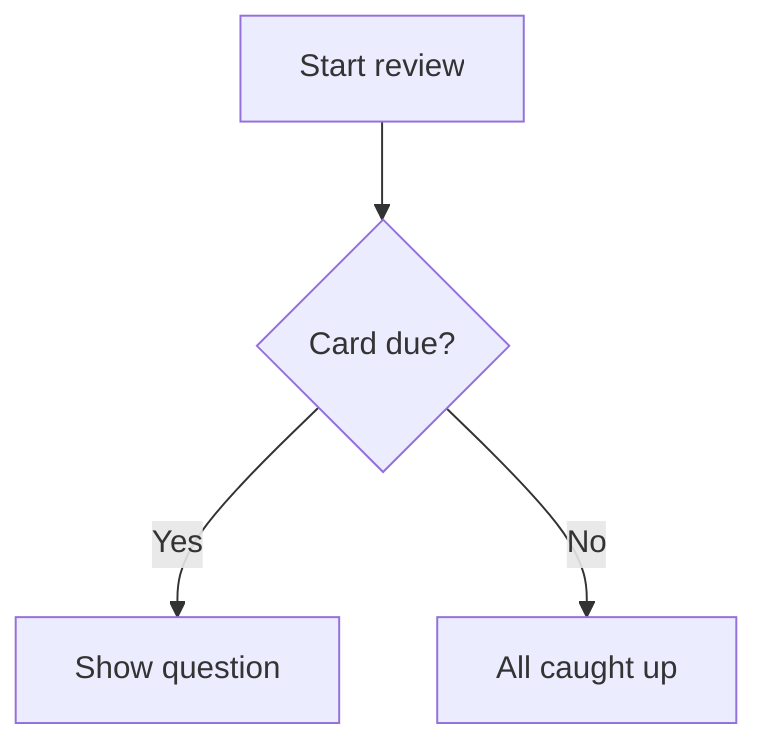

# Cómo escribir buenas tarjetas {#writing-cards number="3"}

::: lede
Una tarjeta es una pregunta y una respuesta. Todo lo demás es opcional,
y ahí empieza lo divertido. Bajo el sencillo campo de texto hay un
lenguaje de marcado pequeño y amable: huecos para rellenar, matemáticas
bien compuestas, código resaltado, diagramas, tablas y palabras que se
leen en voz alta exactamente como tú quieres.
:::

::: inthischapter
- Oriéntate por el editor de tarjetas
- Da estilo al texto, añade enlaces y crea tarjetas de huecos
- Pon matemáticas, código, diagramas y tablas en una tarjeta
- Añade imágenes que se vean bien en modo claro *y* oscuro
- Dile a la voz qué decir, y conoce los cuatro sitios donde te escucha
- Escribe tarjetas que tu memoria de verdad conserve
:::

## El editor de tarjetas de un vistazo {#editor}

:::: split
{.phone}

::: text
Cada tarjeta tiene dos caras, **Pregunta** y **Respuesta**, y cada una
se edita por separado. Una cara tiene tres pestañas:

- **Texto**: lo que escribes, con la barra de formato encima.
- **Imagen**: una imagen de Fotos (o pegada en el texto).
- **Audio**: un archivo de audio, como `.mp3`, `.m4a` o `.wav`.

Debajo del campo de texto encontrarás [Ayuda de formato]{.ui} (una
versión de bolsillo de este capítulo, siempre a un toque) y el
[Idioma]{.ui} de esa cara.

Una cara no puede estar vacía: tanto la pregunta como la respuesta
necesitan texto, una imagen o un sonido antes de que [Guardar]{.ui} se
active. También importa desde qué pestaña guardas: el capítulo 4 explica
cómo combinar texto con una imagen o un sonido sin perder ninguno.
:::
::::

### La barra de herramientas

Nunca *tienes* que acordarte del marcado. La barra que hay encima del
campo de texto lo inserta por ti, envolviendo lo que tengas
seleccionado. Se desplaza de lado; de izquierda a derecha:

| Botón | Inserta |
|---|---|
| Imagen | la imagen de esa cara, en el cursor |
| **B** / *I* | `**bold**` / `*italic*` |
| `</>` | `` `inline code` `` |
| *f(x)* / Σ | `$inline maths$` / un bloque de matemáticas `$$` |
| Forma de onda | `[shown]{spoken}`: una pista hablada |
| Hueco | `{{c1::…}}`: un hueco para rellenar |
| Enlace | `[label](https://…)` |
| Tabla | una tabla de dos columnas |
| Diagrama | un bloque de diagrama `mermaid` |
| Texto grande | un bloque `::: hero` |

### El idioma importa

El selector de [Idioma]{.ui} le dice a JustFlip! qué voz debe leer en
voz alta esa cara, y cada cara tiene el suyo: una palabra en inglés en
el anverso y su significado en español en el reverso.

::: gotcha
#### Sin idioma, no hay voz

Una tarjeta nueva empieza con el idioma en **Ninguno**, y una cara sin
idioma simplemente *no se lee*: ni con el botón del altavoz ni con Leer
tarjetas. Si una tarjeta se queda muda, revisa primero su idioma.
:::

### Etiquetas y marcas

Las etiquetas se escriben en un campo de chips: pulsa Intro, el botón
**+** o una coma para convertir el texto en una etiqueta. Pega
`verbos, irregulares, A2` y obtendrás tres chips de golpe. Las
mayúsculas no importan y los duplicados se descartan. Una marca de color
hace que una tarjeta destaque cuando hojeas un mazo.

## Texto que se ve bien {#text}

El texto de las tarjetas es Markdown, simplificado para pantallas
pequeñas. Esto es todo lo que da forma al texto normal:

:::: pair
```markdown
Las mitocondrias son la **central
energética** de la *célula*. La función
es `atp_synthase()`.
```

::: {.card side="answer"}
Las mitocondrias son la **central energética** de la *célula*. La
función es `atp_synthase()`.
:::
::::

- `**bold**` y `*italic*`: énfasis.
- `` `code` ``: un fragmento en monoespaciado.
- `\*`: una barra invertida muestra el siguiente carácter tal cual, así
  que `\*not italic\*` conserva sus asteriscos.
- Una **línea en blanco** empieza un párrafo nuevo; un salto de línea
  simple se conserva tal cual.

::: note
#### Lo que falta a propósito

Las tarjetas son pequeñas, así que algunas costumbres de Markdown no se
aplican. Una línea que empieza por `# ` se muestra como texto normal: se
quitan las almohadillas, porque en una tarjeta no hay títulos. Los
marcadores de lista como `-` o `1.` aparecen exactamente como los
escribiste, que normalmente es lo que quieres de todos modos.
:::

### Enlaces

`[the guide](https://example.com)` muestra *the guide* como un enlace
que se puede tocar. Funcionan los enlaces web (`https://`), de correo
(`mailto:`) y de teléfono (`tel:`); cualquier otro tipo de enlace se
muestra como texto normal.

## Rellena los huecos {#cloze}

Una tarjeta de **huecos** (cloze) oculta parte de una frase. La pregunta
muestra un hueco; al voltear la tarjeta aparecen las palabras que
faltan, resaltadas. Es la forma más rápida de convertir un párrafo de
apuntes en algo sobre lo que te puedan examinar.

:::: pair
```markdown
La capital de Francia
es {{c1::París}}.
```

::: {.card side="question"}
La capital de Francia es [[…]]{.blank}.
:::
::::

Añade una **pista** después de un segundo par de dos puntos. La pista
aparece dentro del hueco, y es lo que dice la voz en lugar de las palabras
«espacio en blanco»:

:::: pair
```markdown
Las {{c1::mitocondrias::orgánulo}}
producen la mayor parte del ATP
de la célula.
```

::: {.card side="question"}
Las [[orgánulo]]{.blank} producen la mayor parte del ATP de la célula.
:::
::::

Al voltear la tarjeta, la frase entera vuelve con las respuestas
marcadas: las [mitocondrias]{.reveal} producen la mayor parte del ATP de
la célula. La cara de la respuesta de una tarjeta de huecos es opcional.
Lo que escribas ahí se muestra debajo de la frase revelada como notas
adicionales.

::: gotcha
#### Todos los huecos de una tarjeta se ocultan a la vez

Numera tus huecos `c1`, `c2`, `c3`…, pero en JustFlip! todos los huecos
de una tarjeta se ocultan y se revelan *a la vez*, y la tarjeta se
repasa como un único elemento. ¿Quieres que te pregunte cada hueco por
separado? Haz una tarjeta por hueco.

Quien venga de Anki conocerá el otro comportamiento: allí, cada número
se convierte en su propia tarjeta. Eso es exactamente lo que ocurre
cuando **importas** una nota cloze de Anki: se divide en una tarjeta por
número, así que no pierdes nada de lo que estudiaste en Anki.
:::

Algunos detalles que te ahorrarán quebraderos de cabeza:

- Solo cuentan los huecos bien formados. `{{c0::x}}`, `{{c1::}}` o
  `{{not a cloze}}` se muestran tal cual, con llaves y todo.
- ¿Necesitas las propias llaves? Escribe `\{\{c1::…}}`.
- Dentro del código y de las matemáticas, `{{c1::…}}` no se toca: se
  queda literal.

## Grande y centrado {#display}

Algunas tarjetas son un solo carácter: un kana, un kanji, un símbolo
químico, el nombre de un acorde. Ponlo dentro de un bloque **hero** y
llenará la tarjeta:

:::: pair
```markdown
::: hero
あ
:::
```

::: {.card side="question" .hero}
あ
:::
::::

`::: center` hace lo mismo sin cambiar el tamaño: el contenido
simplemente se centra. Abre el bloque con `::: hero` o `::: center` en
su propia línea y ciérralo con `:::`.

::: tip
#### Deja que el tamaño haga de énfasis

Deja las notas *fuera* del bloque, para que sigan siendo texto normal, y
no uses negrita ni cursiva dentro de un bloque hero. A ese tamaño solo
añaden ruido.
:::

## Matemáticas {#maths}

JustFlip! compone las matemáticas con sintaxis TeX, la notación que usan
los matemáticos de todo el mundo. Envuelve una fórmula entre dólares
simples para mantenerla en la línea, o ponla entre líneas `$$` para
darle su propia fila centrada:

:::: pair
```markdown
La derivada:

$$
f'(x) = \lim_{h\to 0}\frac{f(x+h)-f(x)}{h}
$$
```

::: {.card side="answer"}
La derivada:

$$f'(x) = \lim_{h\to 0}\frac{f(x+h)-f(x)}{h}$$
:::
::::

{.shot width=78%}

Las matemáticas en línea funcionan igual: `$E = mc^2$` se convierte en
$E = mc^2$ dentro de la propia frase. Cómo hacer que una fórmula *suene*
bien cuando se lee en voz alta se explica en
[Dile a la voz qué decir](#speech).

## Código {#code}

Delimita el código con tres comillas invertidas y escribe el nombre del
lenguaje tras las de apertura. JustFlip! colorea palabras clave,
cadenas, comentarios, números y tipos:

:::: pair
````markdown
```swift
let answer = 6 * 7
// prints 42
print(answer)
```
````

::: {.card side="answer"}
```swift
let answer = 6 * 7
// prints 42
print(answer)
```
:::
::::

Nombres de lenguaje reconocidos: Swift, Python, JavaScript, TypeScript,
Java, Kotlin, C, C++, C#, Objective-C, Go, Rust, Ruby, PHP, SQL, Bash,
Smalltalk/Pharo, JSON y YAML. Un nombre desconocido o ausente te da
igualmente un bloque monoespaciado limpio, solo que sin colores. El
texto dentro de un bloque de código se muestra exactamente como está
escrito; ahí no se aplica ningún marcado.

## Diagramas {#diagrams}

Un bloque de código llamado `mermaid` no se muestra como código: JustFlip!
lo dibuja. Admite diagramas de flujo, de secuencia, de estados, de
clases y de entidad-relación.

:::: pair
````markdown

````

{.card-shot}
::::

::: tip
#### Diagramas a la medida de una tarjeta

Apunta a unas ocho cajas con etiquetas cortas. Empieza con `graph TD`
(de arriba abajo); JustFlip! puede girar un diagrama de flujo si así
encaja mejor en la tarjeta. Para ver los detalles, el botón **Ampliar**
abre el diagrama a pantalla completa.
:::

## Tablas {#tables}

Las comparaciones pequeñas se leen mejor en una tabla. Deja una línea en
blanco encima; la primera fila es el encabezado y se muestra en negrita:

:::: pair
```markdown
| Tiempo | Forma |
|---|---|
| Presente | yo voy |
| Pretérito | yo fui |
| Perfecto | yo he ido |
```

::: {.card side="answer"}
| Tiempo | Forma |
|---|---|
| Presente | yo voy |
| Pretérito | yo fui |
| Perfecto | yo he ido |
:::
::::

Las celdas admiten el mismo formato que el resto de la tarjeta:
negrita, código, matemáticas. Para mostrar una `|` dentro de una celda,
escribe `\|`.

::: gotcha
#### Dos columnas, cinco filas

Una tabla de tarjeta tiene como máximo **2 columnas y 5 filas**,
encabezado incluido. Lo que pase de ahí se omite y se marca con puntos
suspensivos. Se aceptan los dos puntos de alineación como
`|:---|---:|`, pero las columnas siempre se alinean a la izquierda. Una
tabla más grande suele ser señal de que la tarjeta quiere ser varias
tarjetas.
:::

## Imágenes {#pictures}

Cada cara de una tarjeta admite **una imagen**. Añádela en la pestaña
Imagen, o con el botón de imagen de la barra de texto, que además
inserta un marcador en el texto:

```markdown
Which bird is this?

![attachment:0]
```

El marcador, `![attachment:0]`, decide *dónde* va la imagen dentro del
texto. Un marcador sin imagen detrás simplemente no muestra nada.

La imagen también tiene un campo de **descripción**. VoiceOver se la lee
a quien no puede ver la imagen, así que merece la pena escribir unas
palabras.

::: gotcha
#### Las imágenes transparentes desaparecen en modo oscuro

Una tarjeta dibuja tu imagen exactamente como es, sin fondo detrás.
Unas líneas negras sobre fondo transparente se ven perfectas en una
tarjeta clara y desaparecen por completo en una oscura. Ponles un fondo
blanco sólido a los diagramas, la notación y los dibujos de líneas antes
de añadirlos.
:::

Usa fotos y mapas de bits (PNG, JPEG). Los archivos SVG no se admiten.
No hace falta reducir antes las fotos grandes: JustFlip! reduce la
imagen a 3.000 píxeles por su lado largo al guardar, lo que mantiene
ágil la sincronización con iCloud en todos tus dispositivos. El
capítulo 4 cuenta más sobre las imágenes que funcionan bien.

## Dile a la voz qué decir {#speech}

JustFlip! puede leer en voz alta cualquier tarjeta, con la voz del
idioma de esa cara. Normalmente acierta. Cuando no (una sigla, un
símbolo, una fórmula), puedes darle una **pista hablada**: unas llaves
justo detrás de algo le dicen a la voz que diga *esto* en su lugar.

:::: pair
```markdown
Activa la actualización en segundo
plano de [iOS]{ai ou ese}.
```

::: {.card side="question" spoken="Activa la actualización en segundo plano de ai ou ese."}
Activa la actualización en segundo plano de iOS.
:::
::::

La tarjeta sigue mostrando *iOS*; la voz dice «ai ou ese». La misma
regla funciona exactamente en cuatro sitios:

| Dónde | Tú escribes |
|---|---|
| Cualquier texto, entre corchetes | `[Do♯ menor]{do sostenido menor}` |
| Matemáticas en línea | `$c^2${c al cuadrado}` |
| Un bloque de matemáticas, tras el `$$` de cierre | `$${V igual a S p v}` |
| Una imagen | `![attachment:0]{una manzana roja}` |

Sin pista, el texto se lee con normalidad, las matemáticas se leen a
partir de su código fuente y las imágenes no dicen nada.

::: gotcha
#### Las llaves detrás de cualquier otra cosa se muestran

Una pista solo funciona en esos cuatro sitios. Detrás de negrita,
cursiva o texto suelto, las llaves se muestran en la tarjeta:

- `*Fa♯ mayor*{fa sostenido mayor}` → la tarjeta muestra *Fa♯ mayor*{fa
  sostenido mayor}
- `*[Fa♯ mayor]{fa sostenido mayor}*` → la tarjeta muestra *Fa♯ mayor* y
  la voz dice «fa sostenido mayor»

Ante la duda, usa corchetes. Pon cualquier estilo *fuera* de ellos.
:::

::: tip
#### Pistas para lo que la voz dice mal

Las pistas son para sostenidos y bemoles, fórmulas, abreviaturas y
sílabas romanizadas: cosas con las que tropieza la síntesis de voz. No
hace falta repetir lo que ya está escrito. Y para tener mejores voces en
general, descarga una voz mejorada o premium en los ajustes del sistema,
en **Accesibilidad › Lectura y voz › Voces**, y luego elígela en
JustFlip! en **Ajustes › Voz › Voces**.
:::

## Cuando una tarjeta es demasiado larga {#fitting}

JustFlip! intenta primero que todo quepa en la tarjeta. Si el texto no
cabe, se encoge un poco, hasta el 80 % del tamaño normal. Si aún no
cabe, el texto se corta en la última línea completa y la parte de abajo
de la tarjeta se difumina.

Pero no se pierde nada. El botón **•••**, abajo en la tarjeta, abre el
contenido completo de esa cara en una hoja. En una tarjeta cuyo
diagrama o imagen sí cabe, en ese mismo sitio aparece **Ampliar**, que
abre la imagen a pantalla completa.

Es una red de seguridad, no un estilo de escritura. Una tarjeta que no
puedes leer de un vistazo suele ser dos o tres tarjetas haciéndose
pasar por una.

## Tarjetas que tu memoria conservará {#good-cards}

El formato hace que una tarjeta sea agradable. Estos hábitos hacen que
*funcione*:

1. **Un dato por tarjeta.** «¿Cuáles son los tres poderes del Estado?»
   es una tarjeta que falla la mitad de las veces. Tres tarjetas, una
   por poder, aciertan cada una por su cuenta.
2. **Pregunta con precisión.** Una pregunta que admite dos respuestas
   correctas no te enseñará ninguna. Añade contexto (o una pista en el
   hueco) hasta que solo encaje una respuesta.
3. **Usa tus propias palabras.** Reformular algo es la primera
   repetición, y sale gratis.
4. **Añade una imagen o un sonido** siempre que la cosa *sea* visual o
   sonora: un pájaro, un acorde, una pronunciación.
5. **Que el texto de las preguntas no se repita dentro de un mazo.**

::: gotcha
#### Dos tarjetas, una pregunta

Cuando importas un archivo de mazo (capítulo 5), una tarjeta cuyo texto
de pregunta coincide con el de una tarjeta que ya está en ese mazo
*actualiza* esa tarjeta en lugar de añadir una nueva. Eso hace que
volver a importar un mazo sea seguro. Pero también significa que dos
tarjetas con exactamente el mismo texto de pregunta («¿Qué nota es
esta?», por ejemplo) se convierten en una. Pon la consigna común en el
nombre del mazo, o deja vacío el texto de la pregunta en las tarjetas
que son solo imagen.
:::

## Chuleta {#cheat-sheet .cheatsheet}

| Tú escribes | Obtienes |
|---|---|
| `**bold**` · `*italic*` | **negrita** · *cursiva* |
| `` `code` `` | un fragmento en monoespaciado |
| `\*` | un `*` literal |
| `[label](https://…)` | un enlace (`https`, `mailto`, `tel`) |
| `{{c1::answer}}` | un hueco, que se revela al voltear |
| `{{c1::answer::hint}}` | un hueco que muestra una pista |
| `::: hero` … `:::` | contenido muy grande y centrado |
| `::: center` … `:::` | contenido centrado |
| `$x^2$` | matemáticas en línea |
| `$$` … `$$` | un bloque de matemáticas centrado |
| ```` ```swift ```` … ```` ``` ```` | código resaltado |
| ```` ```mermaid ```` … ```` ``` ```` | un diagrama |
| `| A | B |` + `|---|---|` | una tabla, máx. 2 × 5 |
| `![attachment:0]` | la imagen de esa cara, aquí |
| `[shown]{spoken}` | decir en voz alta otra cosa |
| `$x^2${x al cuadrado}` | una fórmula hablada |
| `![attachment:0]{una manzana roja}` | una imagen hablada |
