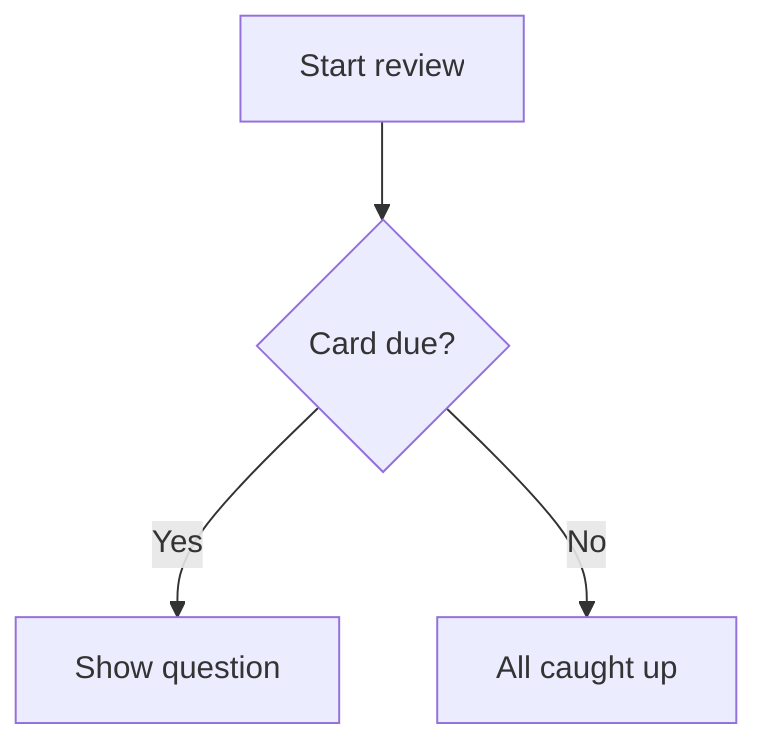

# Écrire de bonnes cartes {#writing-cards number="3"}

::: lede
Une carte, c’est une question et une réponse. Tout le reste est
facultatif — et c’est là que ça devient amusant. Sous le simple champ de
texte se cache un petit langage de balisage bien sympathique : des trous
à remplir, des maths joliment composées, du code coloré, des diagrammes,
des tableaux et des mots lus à voix haute exactement comme tu le
souhaites.
:::

::: inthischapter
- Te repérer dans l’éditeur de carte
- Mettre en forme le texte, ajouter des liens et créer des cartes à trous
- Mettre des maths, du code, des diagrammes et des tableaux sur une carte
- Ajouter des images qui rendent bien en mode clair *et* sombre
- Dire à la voix quoi prononcer — et connaître les quatre endroits où elle t’écoute
- Écrire des cartes que ta mémoire gardera vraiment
:::

## L’éditeur de carte en un coup d’œil {#editor}

:::: split
{.phone}

::: text
Chaque carte a deux côtés, **Question** et **Réponse**, et chaque côté se
modifie séparément. Un côté comporte trois onglets :

- **Texte** — ce que tu tapes, avec la barre de mise en forme au-dessus.
- **Image** — une image depuis Photos (ou collée dans le texte).
- **Audio** — un fichier audio, par exemple `.mp3`, `.m4a` ou `.wav`.

Sous le champ de texte, tu trouveras [Aide à la mise en forme]{.ui} — une
version de poche de ce chapitre, toujours à portée de doigt — et la
[Langue]{.ui} du côté.

Un côté ne peut pas être vide : la question comme la réponse ont besoin
d’un texte, d’une image ou d’un son pour que [Enregistrer]{.ui}
s’active. L’onglet depuis lequel tu enregistres compte aussi — le
chapitre 4 explique comment combiner du texte avec une image ou un son
sans perdre ni l’un ni l’autre.
:::
::::

### La barre d’outils

Tu n’as jamais *besoin* de retenir le balisage. La barre d’outils
au-dessus du champ de texte l’insère pour toi, autour de ce que tu as
sélectionné. Elle défile horizontalement ; de gauche à droite :

| Bouton | Insère |
|---|---|
| Image | l’image du côté, à l’emplacement du curseur |
| **B** / *I* | `**gras**` / `*italique*` |
| `</>` | `` `code en ligne` `` |
| *f(x)* / Σ | `$maths en ligne$` / un bloc de maths `$$` |
| Forme d’onde | `[affiché]{prononcé}` — un indice parlé |
| Texte à trous | `{{c1::…}}` — un trou à remplir |
| Lien | `[libellé](https://…)` |
| Tableau | un tableau à deux colonnes |
| Diagramme | un bloc de diagramme `mermaid` |
| Grand texte | un bloc `::: hero` |

### La langue compte

Le sélecteur [Langue]{.ui} indique à JustFlip! quelle voix doit lire ce
côté à voix haute, et chaque côté a la sienne — un mot espagnol au recto,
sa traduction française au verso.

::: gotcha
#### Pas de langue, pas de voix

Une nouvelle carte démarre avec sa langue réglée sur **Aucune**, et un
côté sans langue n’est tout simplement *pas lu* — ni par le bouton
haut-parleur, ni par Lire les cartes. Si une carte reste muette, vérifie
d’abord sa langue.
:::

### Tags et drapeaux

Les tags se saisissent dans un champ à pastilles : appuie sur Retour, sur
le bouton **+** ou tape une virgule pour transformer le texte en tag.
Colle `verbes, irréguliers, A2` et tu obtiens trois pastilles d’un coup.
La casse n’a pas d’importance et les doublons sont supprimés. Un drapeau
de couleur fait ressortir une carte quand tu parcours un paquet.

## Un texte qui rend bien {#text}

Le texte des cartes est du Markdown, simplifié pour les petits écrans.
Voici tout ce qui façonne le texte simple :

:::: pair
```markdown
Les mitochondries sont la **centrale
énergétique** de la *cellule*. La
fonction est `atp_synthase()`.
```

::: {.card side="answer"}
Les mitochondries sont la **centrale énergétique** de la *cellule*. La
fonction est `atp_synthase()`.
:::
::::

- `**gras**` et `*italique*` — pour mettre en valeur.
- `` `code` `` — un extrait en police à chasse fixe.
- `\*` — une barre oblique inverse affiche le caractère suivant tel quel :
  `\*pas en italique\*` garde donc ses astérisques.
- Une **ligne vide** commence un nouveau paragraphe ; un simple retour à
  la ligne est conservé tel quel.

::: note
#### Ce qui manque volontairement

Les cartes sont petites, donc certaines habitudes Markdown ne s’y
appliquent pas. Une ligne qui commence par `# ` s’affiche en texte
simple — les dièses sont retirés, il n’y a pas de titres sur une carte.
Les marqueurs de liste comme `-` ou `1.` apparaissent exactement comme tu
les as tapés, ce qui est généralement ce que tu veux de toute façon.
:::

### Liens

`[le guide](https://example.com)` affiche *le guide* sous forme de lien
touchable. Les liens web (`https://`), e-mail (`mailto:`) et téléphone
(`tel:`) fonctionnent ; tout autre type de lien s’affiche en texte
simple.

## Textes à trous {#cloze}

Une carte **à trous** masque une partie d’une phrase. La question
affiche un trou ; retourner la carte révèle les mots manquants, mis en
évidence. C’est le moyen le plus rapide de transformer un paragraphe de
notes en quelque chose sur quoi tu peux être interrogé.

:::: pair
```markdown
La capitale de la France
est {{c1::Paris}}.
```

::: {.card side="question"}
La capitale de la France est [[…]]{.blank}.
:::
::::

Ajoute un **indice** après une deuxième paire de deux-points. L’indice
apparaît dans le trou, et c’est ce que la voix prononce à la place du mot
« trou » :

:::: pair
```markdown
{{c1::Les mitochondries::organites}}
produisent l’essentiel de l’ATP
de la cellule.
```

::: {.card side="question"}
[[organites]]{.blank} produisent l’essentiel de l’ATP de la cellule.
:::
::::

Quand la carte est retournée, la phrase entière revient avec les
réponses mises en évidence — [Les mitochondries]{.reveal} produisent
l’essentiel de l’ATP de la cellule. Le côté Réponse d’une carte à trous
est facultatif. Tout ce que tu y écris s’affiche sous la phrase révélée,
comme notes supplémentaires.

::: gotcha
#### Tous les trous d’une carte se masquent ensemble

Numérote tes trous `c1`, `c2`, `c3`… — mais dans JustFlip!, tous les
trous d’une même carte sont masqués et révélés *en même temps*, et la
carte est révisée comme un seul élément. Tu veux être interrogé sur
chaque trou séparément ? Fais une carte par trou.

Les utilisateurs d’Anki connaissent l’autre comportement : là-bas,
chaque numéro devient une carte à part. C’est exactement ce qui se passe
quand tu **importes** une note à trous d’Anki — elle est découpée en une
carte par numéro, si bien que rien de ce que tu as étudié dans Anki n’est
perdu.
:::

Quelques détails qui t’éviteront de te creuser la tête :

- Seuls les trous bien formés comptent. `{{c0::x}}`, `{{c1::}}` ou
  `{{not a cloze}}` s’affichent tels quels, accolades comprises.
- Besoin des accolades elles-mêmes ? Écris `\{\{c1::…}}`.
- Dans le code et les maths, `{{c1::…}}` n’est pas touché — il reste
  tel quel.

## En grand et centré {#display}

Certaines cartes tiennent en un seul caractère : un kana, un kanji, un
symbole chimique, un nom d’accord. Place-le dans un bloc **hero** et il
remplit la carte :

:::: pair
```markdown
::: hero
あ
:::
```

::: {.card side="question" .hero}
あ
:::
::::

`::: center` fait la même chose sans changer la taille — le contenu est
simplement centré. Ouvre le bloc avec `::: hero` ou `::: center` sur sa
propre ligne et ferme-le avec `:::`.

::: tip
#### Laisse la taille faire l’emphase

Garde les éventuelles notes *en dehors* du bloc, pour qu’elles restent en
texte normal, et évite le gras ou l’italique dans un bloc hero. À cette
taille, ils n’ajoutent que du bruit.
:::

## Maths {#maths}

JustFlip! compose les maths avec la syntaxe TeX, la notation utilisée
par les mathématiciens du monde entier. Entoure une formule de dollars
simples pour la garder dans la ligne, ou place-la entre des lignes `$$`
pour lui donner sa propre ligne centrée :

:::: pair
```markdown
La dérivée :

$$
f'(x) = \lim_{h\to 0}\frac{f(x+h)-f(x)}{h}
$$
```

::: {.card side="answer"}
La dérivée :

$$f'(x) = \lim_{h\to 0}\frac{f(x+h)-f(x)}{h}$$
:::
::::

{.shot width=78%}

Les maths en ligne fonctionnent de la même façon : `$E = mc^2$` devient
$E = mc^2$ en plein milieu de la phrase. Comment faire en sorte qu’une
formule *sonne* juste quand elle est lue à voix haute, c’est l’objet de
[Dire à la voix quoi prononcer](#speech).

## Code {#code}

Encadre le code avec trois accents graves et indique le langage après
les accents d’ouverture. JustFlip! colore les mots-clés, les chaînes, les
commentaires, les nombres et les types :

:::: pair
````markdown
```swift
let answer = 6 * 7
// prints 42
print(answer)
```
````

::: {.card side="answer"}
```swift
let answer = 6 * 7
// prints 42
print(answer)
```
:::
::::

Noms de langages reconnus : Swift, Python, JavaScript, TypeScript, Java,
Kotlin, C, C++, C#, Objective-C, Go, Rust, Ruby, PHP, SQL, Bash,
Smalltalk/Pharo, JSON et YAML. Un nom inconnu ou absent te donne quand
même un bloc propre à chasse fixe — simplement sans couleurs. Le texte
d’un bloc de code s’affiche exactement tel qu’il est écrit ; aucun
balisage n’y est appliqué.

## Diagrammes {#diagrams}

Un bloc de code nommé `mermaid` ne s’affiche pas du tout comme du code —
JustFlip! le dessine. Organigrammes, diagrammes de séquence, d’états, de
classes et entité-association sont tous pris en charge.

:::: pair
````markdown

````

{.card-shot}
::::

::: tip
#### Des diagrammes à la taille d’une carte

Vise environ huit boîtes avec des libellés courts. Commence par
`graph TD` (de haut en bas) ; JustFlip! peut faire pivoter un
organigramme quand il tient mieux ainsi sur la carte. Pour les détails,
le bouton **Zoomer** ouvre le diagramme en plein écran.
:::

## Tableaux {#tables}

Les petites comparaisons se lisent mieux sous forme de tableau. Laisse
une ligne vide au-dessus ; la première ligne est l’en-tête et s’affiche
en gras :

:::: pair
```markdown
| Temps | Forme |
|---|---|
| Présent | je vais |
| Imparfait | j’allais |
| Passé composé | je suis allé |
```

::: {.card side="answer"}
| Temps | Forme |
|---|---|
| Présent | je vais |
| Imparfait | j’allais |
| Passé composé | je suis allé |
:::
::::

Les cellules acceptent la même mise en forme que le reste de la carte —
gras, code, maths. Pour afficher un `|` dans une cellule, écris `\|`.

::: gotcha
#### Deux colonnes, cinq lignes

Un tableau sur une carte compte au plus **2 colonnes et 5 lignes**,
en-tête compris. Tout ce qui dépasse est omis et signalé par des points
de suspension. Les deux-points d’alignement comme `|:---|---:|` sont
acceptés, mais les colonnes sont toujours alignées à gauche. Un tableau
plus grand est généralement le signe que la carte veut devenir plusieurs
cartes.
:::

## Images {#pictures}

Chaque côté d’une carte contient **une image**. Ajoute-la dans l’onglet
Image, ou avec le bouton image de la barre d’outils du texte, qui insère
aussi un marqueur dans le texte :

```markdown
Quel est cet oiseau ?

![attachment:0]
```

Le marqueur, `![attachment:0]`, décide *où* l’image se place dans le
texte. Un marqueur sans image derrière n’affiche simplement rien.

L’image a aussi un champ **description**. VoiceOver le lit aux personnes
qui ne peuvent pas voir l’image : il vaut donc la peine d’y mettre
quelques mots.

::: gotcha
#### Les images transparentes disparaissent en mode sombre

Une carte affiche ton image exactement telle qu’elle est, sans fond
derrière. Des traits noirs sur fond transparent rendent parfaitement sur
une carte claire et disparaissent complètement sur une carte sombre.
Donne aux diagrammes, aux notations et aux dessins au trait un fond blanc
uni avant de les ajouter.
:::

Utilise des photos et des images matricielles (PNG, JPEG). Les fichiers
SVG ne sont pas pris en charge. Inutile de réduire les grandes photos
avant : JustFlip! ramène une image à 3 000 pixels sur son grand côté
lorsque tu enregistres, ce qui garde la synchronisation iCloud rapide sur
tous tes appareils. Le chapitre 4 en dit plus sur les images qui
fonctionnent bien.

## Dire à la voix quoi prononcer {#speech}

JustFlip! peut lire n’importe quelle carte à voix haute, avec la voix de
la langue de ce côté. En général, elle s’en sort bien. Quand ce n’est pas
le cas — un sigle, un symbole, une formule — tu peux lui donner un
**indice parlé** : des accolades juste après quelque chose disent à la
voix de prononcer *ceci* à la place.

:::: pair
```markdown
Active l’actualisation en
arrière-plan sur [iOS]{aïe o èsse}.
```

::: {.card side="question" spoken="Active l’actualisation en arrière-plan sur aïe o èsse."}
Active l’actualisation en arrière-plan sur iOS.
:::
::::

La carte affiche toujours *iOS* ; la voix dit « aïe o èsse ». La même
règle fonctionne à exactement quatre endroits :

| Où | Tu écris |
|---|---|
| N’importe quel texte, entre crochets | `[do♯ mineur]{do dièse mineur}` |
| Maths en ligne | `$c^2${c au carré}` |
| Un bloc de maths — après le `$$` de fermeture | `$${V égale S p v}` |
| Une image | `![attachment:0]{une pomme rouge}` |

Sans indice, le texte est lu normalement, les maths sont lues à partir de
leur source, et les images restent muettes.

::: gotcha
#### Des accolades après autre chose s’affichent

Un indice ne fonctionne qu’à ces quatre endroits. Après du gras, de
l’italique ou du texte nu, les accolades s’affichent sur la carte :

- `*fa♯ majeur*{fa dièse majeur}` → la carte affiche *fa♯ majeur*{fa dièse majeur}
- `*[fa♯ majeur]{fa dièse majeur}*` → la carte affiche *fa♯ majeur* et la
  voix dit « fa dièse majeur »

Dans le doute, utilise des crochets. Mets toute mise en forme *à
l’extérieur*.
:::

::: tip
#### Des indices pour ce que la voix prononce mal

Les indices servent pour les dièses et bémols musicaux, les formules, les
abréviations et les syllabes romanisées — tout ce sur quoi la synthèse
vocale trébuche. Inutile de répéter ce qui est déjà écrit. Et pour de
meilleures voix en général, télécharge une voix améliorée ou premium dans
les réglages du système, sous **Accessibilité › Lire et énoncer ›
Voix**, puis choisis-la dans JustFlip! sous **Réglages › Parole ›
Voix**.
:::

## Quand une carte est trop longue {#fitting}

JustFlip! essaie d’abord de tout faire tenir sur la carte. Si le texte ne
tient pas, il rétrécit légèrement, jusqu’à 80 % de la taille normale.
S’il ne tient toujours pas, le texte est coupé à la dernière ligne
complète et le bas de la carte s’estompe en fondu.

Rien n’est perdu pour autant. Le bouton **•••** en bas d’une carte ouvre
tout le contenu de ce côté dans une feuille. Sur une carte dont le
diagramme ou l’image tient, ce même emplacement affiche **Zoomer** à la
place, qui ouvre l’image en plein écran.

C’est un filet de sécurité, pas un style d’écriture. Une carte qu’on ne
peut pas lire d’un coup d’œil, ce sont généralement deux ou trois cartes
qui se font passer pour une seule.

## Des cartes que ta mémoire gardera {#good-cards}

La mise en forme rend une carte agréable. Ces habitudes la rendent
*efficace* :

1. **Un fait par carte.** « Quels sont les trois pouvoirs de l’État ? »
   est une carte qui échoue une fois sur deux. Trois cartes, une par
   pouvoir, réussissent chacune de leur côté.
2. **Pose des questions précises.** Une question qui admet deux bonnes
   réponses ne t’apprendra ni l’une ni l’autre. Ajoute du contexte — ou
   un indice de trou — jusqu’à ce qu’une seule réponse convienne.
3. **Utilise tes propres mots.** Reformuler, c’est déjà une première
   répétition, et elle est gratuite.
4. **Ajoute une image ou un son** chaque fois que la chose *est* visuelle
   ou sonore : un oiseau, un accord, une prononciation.
5. **Garde des questions uniques au sein d’un paquet.**

::: gotcha
#### Deux cartes, une seule question

Quand tu importes un fichier de paquet (chapitre 5), une carte dont le
texte de question correspond à celui d’une carte déjà présente dans ce
paquet *met à jour* cette carte au lieu d’en ajouter une nouvelle. Cela
rend la réimportation d’un paquet sans risque. Mais cela signifie aussi
que deux cartes avec exactement le même texte de question — « Nomme
cette note. », par exemple — n’en font plus qu’une. Mets plutôt la
consigne commune dans le nom du paquet, ou laisse le texte de question
vide sur les cartes qui n’ont qu’une image.
:::

## Aide-mémoire {#cheat-sheet .cheatsheet}

| Tu écris | Tu obtiens |
|---|---|
| `**gras**` · `*italique*` | **gras** · *italique* |
| `` `code` `` | extrait à chasse fixe |
| `\*` | un `*` tel quel |
| `[libellé](https://…)` | un lien (`https`, `mailto`, `tel`) |
| `{{c1::réponse}}` | un trou, révélé au retournement |
| `{{c1::réponse::indice}}` | un trou qui affiche un indice |
| `::: hero` … `:::` | contenu très grand et centré |
| `::: center` … `:::` | contenu centré |
| `$x^2$` | maths en ligne |
| `$$` … `$$` | un bloc de maths centré |
| ```` ```swift ```` … ```` ``` ```` | code coloré |
| ```` ```mermaid ```` … ```` ``` ```` | un diagramme |
| `| A | B |` + `|---|---|` | un tableau, 2 × 5 max. |
| `![attachment:0]` | l’image du côté, ici |
| `[affiché]{prononcé}` | prononcer autre chose à voix haute |
| `$x^2${x au carré}` | une formule prononcée |
| `![attachment:0]{une pomme rouge}` | une image prononcée |
