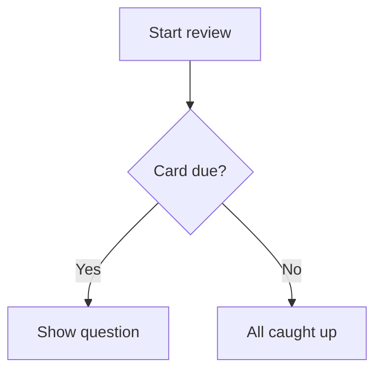

# Scrivere carte efficaci {#writing-cards number="3"}

::: lede
Una carta è una domanda e una risposta. Tutto il resto è facoltativo — ed
è lì che inizia il divertimento. Sotto il semplice campo di testo c'è un
piccolo linguaggio di marcatura, facile da usare: spazi da completare,
formule matematiche impaginate, codice evidenziato, diagrammi, tabelle e
parole lette ad alta voce esattamente come vuoi tu.
:::

::: inthischapter
- Orientati nell'editor delle carte
- Formatta il testo, aggiungi link e crea carte con lacune da completare
- Metti su una carta matematica, codice, diagrammi e tabelle
- Aggiungi immagini che stanno bene in modalità chiara *e* scura
- Di' alla voce cosa pronunciare — e scopri i quattro punti in cui ti ascolta
- Scrivi carte che la tua memoria riuscirà davvero a trattenere
:::

## L'editor delle carte in breve {#editor}

:::: split
{.phone}

::: text
Ogni carta ha due lati, **Domanda** e **Risposta**, e ogni lato si
modifica separatamente. Un lato ha tre schede:

- **Testo** — ciò che scrivi, con la barra di formattazione sopra.
- **Immagine** — una foto da Foto (o incollata nel testo).
- **Audio** — un file audio, come `.mp3`, `.m4a` o `.wav`.

Sotto il campo di testo trovi [Aiuto sulla formattazione]{.ui} — una
versione tascabile di questo capitolo, sempre a portata di tocco — e la
[Lingua]{.ui} del lato.

Un lato non può essere vuoto: sia la domanda sia la risposta devono avere
un testo, un'immagine o un suono prima che [Salva]{.ui} si attivi. Conta
anche da quale scheda salvi — il Capitolo 4 spiega come combinare testo e
immagine o suono senza perdere nessuno dei due.
:::
::::

### La barra degli strumenti

Non *devi* mai ricordare la sintassi. La barra sopra il campo di testo la
inserisce per te, attorno a ciò che hai selezionato. Scorre in
orizzontale; da sinistra a destra:

| Pulsante | Inserisce |
|---|---|
| Immagine | l'immagine del lato, nel punto del cursore |
| **G** / *C* | `**grassetto**` / `*corsivo*` |
| `</>` | `` `codice in linea` `` |
| *f(x)* / Σ | `$formula in linea$` / un blocco di formule `$$` |
| Forma d'onda | `[mostrato]{pronunciato}` — un suggerimento vocale |
| Lacuna | `{{c1::…}}` — uno spazio da completare |
| Link | `[etichetta](https://…)` |
| Tabella | una tabella a due colonne |
| Diagramma | un blocco di diagramma `mermaid` |
| Testo grande | un blocco `::: hero` |

### La lingua conta

Il selettore [Lingua]{.ui} dice a JustFlip! quale voce deve leggere ad
alta voce quel lato, e ogni lato ha il suo — una parola spagnola sul
fronte, il suo significato in italiano sul retro.

::: gotcha
#### Niente lingua, niente voce

Una carta nuova parte con la lingua impostata su **Nessuna**, e un lato
senza lingua semplicemente *non viene letto* — né dal pulsante
dell'altoparlante né da Leggi carte. Se una carta resta muta, controlla
prima di tutto la sua lingua.
:::

### Tag e bandierine

I tag si scrivono in un campo a chip: premi Invio, il pulsante **+** o una
virgola per trasformare il testo in un tag. Incolla `verbi, irregolari, A2`
e ottieni tre chip in un colpo. Maiuscole e minuscole non contano e i
duplicati vengono scartati. Una bandierina colorata fa risaltare una carta
quando sfogli un mazzo.

## Testo come si deve {#text}

Il testo delle carte è Markdown, semplificato per gli schermi piccoli.
Ecco tutto ciò che dà forma al testo semplice:

:::: pair
```markdown
I mitocondri sono la **centrale
energetica** della *cellula*. La
funzione è `atp_synthase()`.
```

::: {.card side="answer"}
I mitocondri sono la **centrale energetica** della *cellula*. La
funzione è `atp_synthase()`.
:::
::::

- `**grassetto**` e `*corsivo*` — enfasi.
- `` `codice` `` — un frammento a spaziatura fissa.
- `\*` — una barra rovesciata mostra letteralmente il carattere
  successivo, quindi `\*non corsivo\*` mantiene i suoi asterischi.
- Una **riga vuota** inizia un nuovo paragrafo; un singolo a capo viene
  mantenuto così com'è.

::: note
#### Cosa manca di proposito

Le carte sono piccole, quindi alcune abitudini di Markdown non valgono.
Una riga che inizia con `# ` viene mostrata come testo semplice — i
cancelletti spariscono, non esistono titoli su una carta. Gli indicatori
di elenco come `-` o `1.` appaiono esattamente come li hai scritti, che di
solito è proprio ciò che vuoi.
:::

### Link

`[la guida](https://example.com)` mostra *la guida* come link toccabile.
Funzionano i link web (`https://`), e-mail (`mailto:`) e telefonici
(`tel:`); qualsiasi altro tipo di link viene mostrato come testo semplice.

## Completa le lacune {#cloze}

Una carta **con lacune** (cloze) nasconde parte di una frase. La domanda
mostra uno spazio vuoto; girando la carta compaiono le parole mancanti,
evidenziate. È il modo più rapido per trasformare un paragrafo di appunti
in qualcosa su cui farti interrogare.

:::: pair
```markdown
La capitale della Francia
è {{c1::Parigi}}.
```

::: {.card side="question"}
La capitale della Francia è [[…]]{.blank}.
:::
::::

Aggiungi un **indizio** dopo una seconda coppia di due punti. L'indizio
appare dentro lo spazio vuoto, ed è ciò che la voce pronuncia al posto
delle parole "spazio vuoto":

:::: pair
```markdown
{{c1::I mitocondri::organelli}}
producono gran parte dell'ATP della cellula.
```

::: {.card side="question"}
[[organelli]]{.blank} producono gran parte dell'ATP della cellula.
:::
::::

Quando giri la carta, l'intera frase ritorna con le risposte evidenziate
— [I mitocondri]{.reveal} producono gran parte dell'ATP della cellula. Il
lato Risposta di una carta con lacune è facoltativo. Ciò che ci scrivi
viene mostrato sotto la frase svelata, come note aggiuntive.

::: gotcha
#### Tutte le lacune di una carta si nascondono insieme

Numera le lacune `c1`, `c2`, `c3`… — ma in JustFlip! tutte le lacune di
una carta vengono nascoste e svelate *nello stesso momento*, e la carta
viene ripassata come un unico elemento. Vuoi essere interrogato su ogni
lacuna separatamente? Crea una carta per lacuna.

Chi usa Anki conosce l'altro comportamento: lì ogni numero diventa una
carta a sé. È esattamente ciò che succede quando **importi** una nota
cloze di Anki — viene divisa in una carta per numero, così non perdi
nulla di ciò che hai studiato in Anki.
:::

Alcuni dettagli che ti risparmiano grattacapi:

- Contano solo le lacune scritte correttamente. `{{c0::x}}`, `{{c1::}}` o
  `{{not a cloze}}` vengono mostrati letteralmente, graffe comprese.
- Ti servono proprio le graffe? Scrivi `\{\{c1::…}}`.
- Dentro codice e formule, `{{c1::…}}` non viene toccato — resta
  letterale.

## Grande e centrato {#display}

Alcune carte sono un solo carattere: un kana, un kanji, un simbolo
chimico, il nome di un accordo. Mettilo in un blocco **hero** e riempirà
la carta:

:::: pair
```markdown
::: hero
あ
:::
```

::: {.card side="question" .hero}
あ
:::
::::

`::: center` fa lo stesso senza cambiare dimensione — il contenuto viene
semplicemente centrato. Apri il blocco con `::: hero` o `::: center` su
una riga a sé e chiudilo con `:::`.

::: tip
#### Lascia che sia la dimensione a dare enfasi

Tieni le eventuali note *fuori* dal blocco, così restano testo normale, ed
evita grassetto e corsivo dentro un blocco hero. A quella dimensione
aggiungono solo rumore.
:::

## Matematica {#maths}

JustFlip! impagina la matematica con la sintassi TeX, la notazione usata
dai matematici di tutto il mondo. Racchiudi una formula tra dollari
singoli per tenerla nella riga, oppure mettila tra due righe `$$` per
darle una riga tutta sua, centrata:

:::: pair
```markdown
La derivata:

$$
f'(x) = \lim_{h\to 0}\frac{f(x+h)-f(x)}{h}
$$
```

::: {.card side="answer"}
La derivata:

$$f'(x) = \lim_{h\to 0}\frac{f(x+h)-f(x)}{h}$$
:::
::::

{.shot width=78%}

Le formule in linea funzionano allo stesso modo: `$E = mc^2$` diventa
$E = mc^2$ direttamente nella frase. Come far *suonare* bene una formula
quando viene letta ad alta voce lo vedrai in
[Di' alla voce cosa pronunciare](#speech).

## Codice {#code}

Delimita il codice con tre apici inversi e scrivi il nome del linguaggio
dopo quelli di apertura. JustFlip! colora parole chiave, stringhe,
commenti, numeri e tipi:

:::: pair
````markdown
```swift
let answer = 6 * 7
// prints 42
print(answer)
```
````

::: {.card side="answer"}
```swift
let answer = 6 * 7
// prints 42
print(answer)
```
:::
::::

Nomi di linguaggio riconosciuti: Swift, Python, JavaScript, TypeScript,
Java, Kotlin, C, C++, C#, Objective-C, Go, Rust, Ruby, PHP, SQL, Bash,
Smalltalk/Pharo, JSON e YAML. Un nome sconosciuto o assente ti dà comunque
un blocco pulito a spaziatura fissa — solo senza colori. Il testo dentro
un blocco di codice viene mostrato esattamente come è scritto; lì non si
applica alcuna formattazione.

## Diagrammi {#diagrams}

Un blocco di codice chiamato `mermaid` non viene affatto mostrato come
codice — JustFlip! lo disegna. Sono supportati diagrammi di flusso, di
sequenza, di stato, delle classi ed entità-relazione.

:::: pair
````markdown

````

{.card-shot}
::::

::: tip
#### Diagrammi a misura di carta

Punta a circa otto riquadri con etichette brevi. Inizia con `graph TD`
(dall'alto in basso); JustFlip! può ruotare un diagramma di flusso in
orizzontale quando così si adatta meglio alla carta. Per i dettagli, il
pulsante **Zoom** apre il diagramma a schermo intero.
:::

## Tabelle {#tables}

I piccoli confronti si leggono meglio in tabella. Lascia una riga vuota
sopra; la prima riga è l'intestazione e viene mostrata in grassetto:

:::: pair
```markdown
| Tempo | Forma |
|---|---|
| Presente | io vado |
| Imperfetto | io andavo |
| Passato prossimo | io sono andato |
```

::: {.card side="answer"}
| Tempo | Forma |
|---|---|
| Presente | io vado |
| Imperfetto | io andavo |
| Passato prossimo | io sono andato |
:::
::::

Le celle accettano la stessa formattazione del resto della carta —
grassetto, codice, formule. Per mostrare un `|` dentro una cella, scrivi
`\|`.

::: gotcha
#### Due colonne, cinque righe

Una tabella su una carta contiene al massimo **2 colonne e 5 righe**,
intestazione compresa. Ciò che va oltre viene tralasciato e segnalato con
dei puntini di sospensione. I due punti di allineamento come `|:---|---:|`
sono accettati, ma le colonne sono sempre allineate a sinistra. Una
tabella più grande di solito è il segno che la carta vuole diventare più
carte.
:::

## Immagini {#pictures}

Ogni lato di una carta contiene **un'immagine**. Aggiungila dalla scheda
Immagine, oppure con il pulsante immagine nella barra del testo, che
inserisce anche un segnaposto nel testo:

```markdown
Che uccello è questo?

![attachment:0]
```

Il segnaposto, `![attachment:0]`, decide *dove* si trova l'immagine
all'interno del testo. Un segnaposto senza immagine dietro semplicemente
non mostra nulla.

L'immagine ha anche un campo **descrizione**. VoiceOver lo legge a chi non
può vedere l'immagine, quindi vale la pena scriverci qualche parola.

::: gotcha
#### Le immagini trasparenti spariscono in modalità scura

Una carta disegna l'immagine esattamente com'è, senza alcuno sfondo
dietro. Linee nere su sfondo trasparente stanno benissimo su una carta
chiara e spariscono del tutto su una scura. Dai a diagrammi, notazioni e
disegni al tratto uno sfondo bianco pieno prima di aggiungerli.
:::

Usa foto e immagini bitmap (PNG, JPEG). I file SVG non sono supportati.
Non serve rimpicciolire prima le foto grandi: quando salvi, JustFlip!
riduce l'immagine a 3.000 pixel sul lato lungo, il che mantiene veloce la
sincronizzazione iCloud su tutti i tuoi dispositivi. Il Capitolo 4
approfondisce le immagini che funzionano bene.

## Di' alla voce cosa pronunciare {#speech}

JustFlip! può leggere ad alta voce qualsiasi carta, con la voce della
lingua di quel lato. Di solito se la cava bene. Quando non è così — una
sigla, un simbolo, una formula — puoi darle un **suggerimento vocale**:
delle parentesi graffe subito dopo qualcosa dicono alla voce di
pronunciare *questo* al suo posto.

:::: pair
```markdown
Attiva l'aggiornamento in
background di [iOS]{ai o esse}.
```

::: {.card side="question" spoken="Attiva l'aggiornamento in background di ai o esse."}
Attiva l'aggiornamento in background di iOS.
:::
::::

La carta mostra sempre *iOS*; la voce dice "ai o esse". La stessa regola
funziona esattamente in quattro punti:

| Dove | Scrivi |
|---|---|
| Qualsiasi testo, tra parentesi quadre | `[Do♯ minore]{do diesis minore}` |
| Formula in linea | `$c^2${c al quadrato}` |
| Un blocco di formule — dopo i `$$` di chiusura | `$${V uguale S p v}` |
| Un'immagine | `![attachment:0]{una mela rossa}` |

Senza suggerimento, il testo viene letto normalmente, le formule vengono
lette a partire dal loro codice sorgente e le immagini restano mute.

::: gotcha
#### Le graffe dopo qualsiasi altra cosa vengono mostrate

Un suggerimento funziona solo in quei quattro punti. Dopo grassetto,
corsivo o testo semplice, le graffe compaiono sulla carta:

- `*Fa♯ maggiore*{fa diesis maggiore}` → la carta mostra
  *Fa♯ maggiore*{fa diesis maggiore}
- `*[Fa♯ maggiore]{fa diesis maggiore}*` → la carta mostra
  *Fa♯ maggiore* e la voce dice "fa diesis maggiore"

Nel dubbio, usa le parentesi quadre. Metti la formattazione *fuori* da
esse.
:::

::: tip
#### Suggerimenti per ciò che la voce sbaglia

I suggerimenti servono per diesis e bemolle, formule, abbreviazioni e
sillabe traslitterate — cose su cui la sintesi vocale inciampa. Non
c'è bisogno di ripetere ciò che è già scritto. E per avere voci migliori
in generale, scarica una voce migliorata o premium nelle impostazioni di
sistema, in **Accessibilità › Lettura e voce › Voci**, poi selezionala in
JustFlip! in **Impostazioni › Voce › Voci**.
:::

## Quando una carta è troppo lunga {#fitting}

JustFlip! prova prima a far stare tutto sulla carta. Se il testo non ci
sta, lo rimpicciolisce leggermente, fino all'80 % della dimensione
normale. Se ancora non ci sta, il testo viene tagliato all'ultima riga
intera e il fondo della carta sfuma.

Però non si perde nulla. Il pulsante **•••** in fondo a una carta apre in
un pannello il contenuto completo di quel lato. Su una carta il cui
diagramma o la cui immagine ci sta, nello stesso punto c'è invece
**Zoom**, che apre l'immagine a schermo intero.

È una rete di sicurezza, non uno stile di scrittura. Una carta che non
riesci a leggere con un'occhiata di solito è due o tre carte che fingono
di essere una sola.

## Carte che la tua memoria tratterrà {#good-cards}

La formattazione rende piacevole una carta. Queste abitudini la fanno
*funzionare*:

1. **Un fatto per carta.** "Quali sono i tre poteri dello Stato?" è una
   carta che fallisce una volta su due. Tre carte, una per potere,
   funzionano ognuna per conto suo.
2. **Chiedi con precisione.** Una domanda che ammette due risposte giuste
   non te ne insegnerà nessuna. Aggiungi contesto — o un indizio nella
   lacuna — finché non resta una sola risposta possibile.
3. **Usa parole tue.** Riformulare qualcosa è la prima ripetizione, ed è
   gratis.
4. **Aggiungi un'immagine o un suono** ogni volta che la cosa *è* visiva o
   sonora: un uccello, un accordo, una pronuncia.
5. **Mantieni unici i testi delle domande all'interno di un mazzo.**

::: gotcha
#### Due carte, una domanda

Quando importi un file di mazzo (Capitolo 5), una carta il cui testo della
domanda coincide con quello di una carta già presente nel mazzo
*aggiorna* quella carta invece di aggiungerne una nuova. Questo rende
sicuro reimportare un mazzo. Ma significa anche che due carte con
esattamente lo stesso testo della domanda — per esempio "Che nota è
questa?" — diventano una sola carta. Metti piuttosto la domanda comune nel
nome del mazzo, oppure lascia vuoto il testo della domanda nelle carte
con sola immagine.
:::

## Promemoria {#cheat-sheet .cheatsheet}

| Scrivi | Ottieni |
|---|---|
| `**grassetto**` · `*corsivo*` | **grassetto** · *corsivo* |
| `` `codice` `` | frammento a spaziatura fissa |
| `\*` | un `*` letterale |
| `[etichetta](https://…)` | un link (`https`, `mailto`, `tel`) |
| `{{c1::risposta}}` | una lacuna, svelata quando giri la carta |
| `{{c1::risposta::indizio}}` | una lacuna che mostra un indizio |
| `::: hero` … `:::` | contenuto molto grande e centrato |
| `::: center` … `:::` | contenuto centrato |
| `$x^2$` | formula in linea |
| `$$` … `$$` | un blocco di formule centrato |
| ```` ```swift ```` … ```` ``` ```` | codice evidenziato |
| ```` ```mermaid ```` … ```` ``` ```` | un diagramma |
| `| A | B |` + `|---|---|` | una tabella, max 2 × 5 |
| `![attachment:0]` | l'immagine del lato, qui |
| `[mostrato]{pronunciato}` | pronuncia qualcos'altro ad alta voce |
| `$x^2${x al quadrato}` | una formula pronunciata |
| `![attachment:0]{una mela rossa}` | un'immagine pronunciata |
