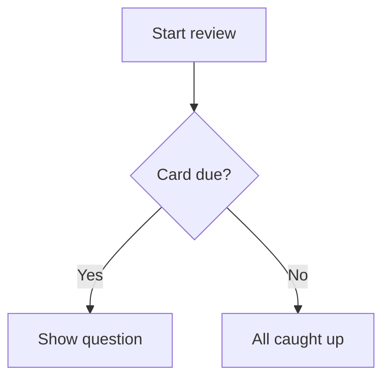

# よいカードの書き方 {#writing-cards number="3"}

::: lede
カードは問題と答えでできています。それ以外はすべて任意ですが、楽しいのはそこからです。シンプルなテキストフィールドの裏には、小さくて親しみやすいマークアップ言語があります。穴埋めの空欄、組版された数式、色分けされたコード、ダイアグラム、表、そして思いどおりに読み上げられる言葉。
:::

::: inthischapter
- カードエディタの使い方を知る
- テキストに書式を付け、リンクや穴埋め（クローズ）カードを追加する
- カードに数式、コード、ダイアグラム、表を入れる
- ライトモードでも*ダーク*モードでもきれいに見える画像を追加する
- 読み上げる内容を声に伝え、それが効く 4 つの場所を覚える
- 記憶にしっかり残るカードを書く
:::

## カードエディタの概要 {#editor}

:::: split
{.phone}

::: text
どのカードにも**問題**と**解答**の 2 つの面があり、それぞれ別々に編集します。各面には 3 つのタブがあります。

- **テキスト**：入力する内容。上に書式ツールバーがあります。
- **画像**：「写真」から選んだ（またはテキストに貼り付けた）画像 1 枚。
- **オーディオ**：`.mp3`、`.m4a`、`.wav` などのオーディオファイル。

テキストフィールドの下には、[書式設定のヘルプ]{.ui}（この章をポケットサイズにしたもので、いつでもワンタップで開けます）と、その面の [言語]{.ui} があります。

面を空にすることはできません。問題と解答の両方にテキスト、画像、または音声が入っていないと、[保存]{.ui} は押せるようになりません。どのタブで保存するかも重要です。テキストと画像や音声を、どちらも失わずに組み合わせる方法は第 4 章で説明します。
:::
::::

### ツールバー

マークアップを覚える*必要*はまったくありません。テキストフィールドの上のツールバーが、選択した部分を囲む形でマークアップを挿入してくれます。ツールバーは横にスクロールでき、左から順に次のボタンが並んでいます。

| ボタン | 挿入される内容 |
|---|---|
| 画像 | その面の画像を、カーソルの位置に |
| **B** / *I* | `**bold**` / `*italic*` |
| `</>` | `` `inline code` `` |
| *f(x)* / Σ | `$inline maths$` / `$$` の数式ブロック |
| 波形 | `[shown]{spoken}`：読み上げのヒント |
| 穴埋め | `{{c1::…}}`：穴埋めの空欄 |
| リンク | `[label](https://…)` |
| 表 | 2 列の表 |
| 図 | `mermaid` のダイアグラムブロック |
| 大きな文字 | `::: hero` ブロック |

### 言語は大切です

[言語]{.ui} の選択は、その面をどの声で読み上げるかを JustFlip! に伝えます。面ごとに別々に設定できます。たとえば表面にスペイン語の単語、裏面にその日本語の意味、といった具合です。

::: gotcha
#### 言語がなければ、声も出ません

新しいカードの言語は**なし**から始まり、言語のない面は*読み上げられません*。スピーカーボタンでも、「カードを読み上げ」でも同じです。カードが黙ったままなら、まず言語を確認してください。
:::

### タグとフラグ

タグはチップ形式の入力欄に入力します。Return キー、**+** ボタン、またはカンマを押すと、テキストがタグになります。`verbs, irregular, A2` を貼り付ければ、一度に 3 つのチップができます。大文字と小文字は区別されず、重複は取り除かれます。色のフラグを付けると、デッキを見るときにそのカードが目立ちます。

## きれいに見えるテキスト {#text}

カードのテキストは、小さな画面向けに簡略化した Markdown です。プレーンテキストの見た目を整える要素は次のとおりです。

:::: pair
```markdown
ミトコンドリアは*細胞*の
**発電所**です。関数は
`atp_synthase()` です。
```

::: {.card side="answer"}
ミトコンドリアは*細胞*の**発電所**です。関数は`atp_synthase()` です。
:::
::::

- `**bold**` と `*italic*`：強調。
- `` `code` ``：等幅のコード片。
- `\*`：バックスラッシュを付けると次の文字がそのまま表示されるので、`\*not
  italic\*` はアスタリスクが残ります。
- **空行**で新しい段落になります。1 つだけの改行はそのまま保たれます。

::: note
#### あえて省いているもの

カードは小さいので、Markdown のいくつかの書き方は使えません。`# ` で始まる行はプレーンテキストとして表示されます。シャープ記号は取り除かれ、カードに見出しはありません。`-` や `1.` などのリスト記号は入力したとおりに表示されますが、たいていはそれで十分でしょう。
:::

### リンク

`[the guide](https://example.com)` と書くと、*the guide* がタップできるリンクとして表示されます。Web（`https://`）、メール（`mailto:`）、電話（`tel:`）のリンクが使えます。それ以外の種類のリンクはプレーンテキストとして表示されます。

## 穴埋め {#cloze}

**穴埋め（クローズ）**カードは、文の一部を隠します。問題面には空欄が表示され、カードをめくると隠れていた言葉が強調表示されて現れます。ノートの 1 段落を、テストできる形に変えるいちばんの近道です。

:::: pair
```markdown
フランスの首都は
{{c1::パリ}}です。
```

::: {.card side="question"}
フランスの首都は[[…]]{.blank}です。
:::
::::

2 つ目のコロンのペアのあとに**ヒント**を付けられます。ヒントは空欄の中に表示され、声は「空欄」の代わりにヒントを読み上げます。

:::: pair
```markdown
{{c1::ミトコンドリア::細胞小器官}}は
細胞の ATP の大部分を作ります。
```

::: {.card side="question"}
[[細胞小器官]]{.blank}は細胞の ATP の大部分を作ります。
:::
::::

カードをめくると、答えに印が付いた状態で文全体が戻ってきます。[ミトコンドリア]{.reveal}は細胞の ATP の大部分を作ります。穴埋めカードの解答面は任意です。そこに書いた内容は、答えが表示された文の下に補足として表示されます。

::: gotcha
#### カードの空欄はすべて一緒に隠れます

空欄には `c1`、`c2`、`c3`… と番号を付けますが、JustFlip! ではひとつのカードのすべての空欄が*同時に*隠れて同時に現れ、カードはひとつの項目として復習されます。空欄ごとに別々にテストしたい場合は、空欄ごとにカードを 1 枚ずつ作ってください。

Anki のユーザーなら別の動作をご存じでしょう。Anki では番号ごとに別のカードになります。Anki の穴埋めノートを**読み込む**と、まさにそのとおりになります。番号ごとに 1 枚のカードに分けられるので、Anki で学習した内容は何も失われません。
:::

頭を悩ませずに済む、いくつかの細かな点です。

- 正しい形の空欄だけが有効です。`{{c0::x}}`、`{{c1::}}`、`{{not a cloze}}` は、波かっこも含めてそのまま表示されます。
- 波かっこそのものを表示したい場合は、`\{\{c1::…}}` と書きます。
- コードや数式の中の `{{c1::…}}` はそのまま、文字どおりに表示されます。

## 大きく、中央に {#display}

1 文字だけのカードもあります。かな、漢字、元素記号、コード名など。それを **hero** ブロックに入れると、カードいっぱいに表示されます。

:::: pair
```markdown
::: hero
あ
:::
```

::: {.card side="question" .hero}
あ
:::
::::

`::: center` は、サイズを変えずに同じことをします。内容が中央に配置されるだけです。ブロックは `::: hero` または `::: center` だけの行で開き、`:::` で閉じます。

::: tip
#### 大きさで強調する

補足はブロックの*外*に書いて通常のテキストのままにし、hero ブロックの中では太字や斜体を使わないようにしましょう。あの大きさでは、かえってうるさくなるだけです。
:::

## 数式 {#maths}

JustFlip! は、世界中の数学者が使っている TeX の記法で数式を組版します。数式を 1 つのドル記号で囲むと文中に、`$$` の行で挟むと独立した中央揃えの行に表示されます。

:::: pair
```markdown
導関数：

$$
f'(x) = \lim_{h\to 0}\frac{f(x+h)-f(x)}{h}
$$
```

::: {.card side="answer"}
導関数：

$$f'(x) = \lim_{h\to 0}\frac{f(x+h)-f(x)}{h}$$
:::
::::

{.shot width=78%}

インライン数式も同じように使えます。`$E = mc^2$` は、文の中でそのまま $E = mc^2$ になります。読み上げたときに数式を正しく*聞こえる*ようにする方法は、[読み上げる内容を声に伝える](#speech)で説明します。

## コード {#code}

コードはバッククォート 3 つで囲み、開始の囲みのあとに言語名を書きます。JustFlip! はキーワード、文字列、コメント、数値、型を色分けします。

:::: pair
````markdown
```swift
let answer = 6 * 7
// prints 42
print(answer)
```
````

::: {.card side="answer"}
```swift
let answer = 6 * 7
// prints 42
print(answer)
```
:::
::::

認識される言語名：Swift、Python、JavaScript、TypeScript、Java、Kotlin、C、C++、C#、Objective-C、Go、Rust、Ruby、PHP、SQL、Bash、Smalltalk/Pharo、JSON、YAML。名前が不明または未指定でも、色が付かないだけで、すっきりした等幅のブロックとして表示されます。コードブロック内のテキストは書いたとおりに表示され、マークアップは適用されません。

## ダイアグラム {#diagrams}

`mermaid` と名前を付けたコードブロックは、コードとしては表示されません。JustFlip! がそれを図として描きます。フローチャート、シーケンス図、状態遷移図、クラス図、ER 図に対応しています。

:::: pair
````markdown

````

{.card-shot}
::::

::: tip
#### カードに収まるダイアグラム

ラベルの短い箱を 8 個程度にとどめましょう。まずは `graph TD`（上から下）で始めてください。カードに収まりやすい場合、JustFlip! はフローチャートを横向きにすることがあります。細部を見るには、**拡大**ボタンで図をフルスクリーン表示できます。
:::

## 表 {#tables}

ちょっとした比較は、表にすると読みやすくなります。表の上には空行を入れてください。最初の行は見出しで、太字で表示されます。

:::: pair
```markdown
| 時制 | 形 |
|---|---|
| 現在 | I go |
| 過去 | I went |
| 現在完了 | I have gone |
```

::: {.card side="answer"}
| 時制 | 形 |
|---|---|
| 現在 | I go |
| 過去 | I went |
| 現在完了 | I have gone |
:::
::::

セルには、カードのほかの部分と同じ書式（太字、コード、数式）が使えます。セルの中に `|` を表示するには、`\|` と書きます。

::: gotcha
#### 2 列、5 行まで

カードの表は、見出しを含めて最大 **2 列 5 行**です。それを超える部分は省かれ、省略記号で示されます。`|:---|---:|` のような配置指定のコロンは受け付けますが、列は常に左揃えになります。表が大きくなるのは、たいていそのカードを何枚かに分けたほうがよいというサインです。
:::

## 画像 {#pictures}

カードの各面には**画像を 1 枚**入れられます。「画像」タブで追加するか、テキストツールバーの画像ボタンを使います。画像ボタンを使うと、テキストに目印も挿入されます。

```markdown
Which bird is this?

![attachment:0]
```

目印 `![attachment:0]` は、テキストの中で画像を*どこに*置くかを決めます。対応する画像がない目印は、何も表示しません。

画像には**説明**の欄もあります。VoiceOver は、画像が見えない人のためにこの説明を読み上げます。ひとこと書いておく価値があります。

::: gotcha
#### 透明な画像はダークモードで消えます

カードは画像をそのまま描き、背後に背景を敷きません。透明な背景に黒い線の画像は、明るいカードでは完璧に見えても、暗いカードではまったく見えなくなります。図、記譜、線画は、追加する前に白一色の背景を付けておきましょう。
:::

写真やビットマップ画像（PNG、JPEG）を使ってください。SVG ファイルには対応していません。大きな写真をあらかじめ縮小する必要はありません。保存時に JustFlip! が長辺 3,000 ピクセルまで縮小するので、すべてのデバイスで iCloud 同期が速く保たれます。うまく機能する画像については第 4 章で詳しく説明します。

## 読み上げる内容を声に伝える {#speech}

JustFlip! は、その面の言語に合った声でどのカードでも読み上げられます。たいていは正しく読んでくれますが、略語、記号、数式などでうまくいかないこともあります。そんなときは**読み上げのヒント**を付けられます。何かの直後に波かっこを書くと、代わりに*その内容*を読み上げるよう声に伝えます。

:::: pair
```markdown
[iOS]{アイオーエス}の
バックグラウンド更新を有効にする。
```

::: {.card side="question" spoken="アイオーエスのバックグラウンド更新を有効にする。"}
iOSのバックグラウンド更新を有効にする。
:::
::::

カードには *iOS* と表示されたまま、声は「アイオーエス」と読みます。このルールが使えるのは、ちょうど次の 4 つの場所です。

| 場所 | 書き方 |
|---|---|
| 任意のテキスト（角かっこで囲む） | `[C♯ minor]{シーシャープ・マイナー}` |
| インライン数式 | `$c^2${シーの二乗}` |
| 数式ブロック：閉じる `$$` のあと | `$${ブイ イコール エス ピー ブイ}` |
| 画像 | `![attachment:0]{赤いりんご}` |

ヒントがない場合、テキストは普通に読み上げられ、数式はソースのまま読み上げられ、画像は読み上げられません。

::: gotcha
#### それ以外のものに続く波かっこは表示されます

ヒントが効くのはこの 4 つの場所だけです。太字、斜体、角かっこのないテキストのあとでは、波かっこがそのままカードに表示されます。

- `*F♯ major*{エフシャープ・メジャー}` → カードには *F♯ major*{エフシャープ・メジャー} と表示されます
- `*[F♯ major]{エフシャープ・メジャー}*` → カードには *F♯ major* と表示され、声は「エフシャープ・メジャー」と読みます

迷ったら角かっこを使い、書式はその*外側*に付けましょう。
:::

::: tip
#### 声が間違えるところにヒントを

ヒントは、音楽のシャープやフラット、数式、略語、ローマ字表記の音節など、音声合成がつまずきやすいもののためにあります。すでに書かれていることを繰り返す必要はありません。全体的にもっとよい声にしたい場合は、システムの設定の **アクセシビリティ › リーダーと読み上げ › 声** で拡張またはプレミアムの声をダウンロードし、JustFlip! の **設定 › 読み上げ › 声** で選んでください。
:::

## カードが長すぎるとき {#fitting}

JustFlip! はまず、すべてをカードに収めようとします。テキストが収まらない場合は、通常の 80 % の大きさまで少し縮小します。それでも収まらない場合は、最後の完全な行でテキストが切られ、カードの下端がフェードアウトします。

それでも何も失われません。カードの下にある **•••** ボタンを押すと、その面の内容全体がシートに表示されます。ダイアグラムや画像が収まっているカードでは、同じ場所に代わりに**拡大**ボタンがあり、画像をフルスクリーンで開けます。

これはあくまで安全網で、書き方のスタイルではありません。ひと目で読めないカードは、たいてい 2〜3 枚のカードが 1 枚のふりをしているのです。

## 記憶に残るカード {#good-cards}

書式はカードを心地よくします。次の習慣は、カードを*効果的*にします。

1. **1 枚に 1 つの事実。** 「三権とは何か？」は、半分の確率で失敗する 1 枚のカードです。権力ごとに 1 枚ずつの 3 枚なら、それぞれがきちんと機能します。
2. **正確に問う。** 正解が 2 つありうる問題では、どちらも身につきません。答えが 1 つに絞られるまで、文脈（または穴埋めのヒント）を加えましょう。
3. **自分の言葉で。** 言い換えること自体が最初の反復で、しかも手間はかかりません。
4. **画像や音声を加える。** 対象そのものが目や耳で捉えるもの（鳥、和音、発音など）なら、ぜひ加えましょう。
5. **デッキ内で問題のテキストが重複しないようにする。**

::: gotcha
#### 2 枚のカード、1 つの問題

デッキファイルを読み込むと（第 5 章）、問題のテキストがそのデッキの既存のカードと一致するカードは、新しく追加されるのではなく、そのカードを*更新*します。これにより、デッキを安心して読み込み直せます。ただし、まったく同じ問題のテキストを持つ 2 枚のカード（たとえば「この音名は？」）は 1 枚になってしまいます。共通の問いかけはデッキ名に入れるか、画像だけのカードでは問題のテキストを空にしておきましょう。
:::

## 早見表 {#cheat-sheet .cheatsheet}

| 書き方 | 結果 |
|---|---|
| `**bold**` · `*italic*` | **太字** · *斜体* |
| `` `code` `` | 等幅のコード片 |
| `\*` | 文字どおりの `*` |
| `[label](https://…)` | リンク（`https`、`mailto`、`tel`） |
| `{{c1::answer}}` | めくると現れる空欄 |
| `{{c1::answer::hint}}` | ヒントを表示する空欄 |
| `::: hero` … `:::` | とても大きく、中央に配置された内容 |
| `::: center` … `:::` | 中央に配置された内容 |
| `$x^2$` | インライン数式 |
| `$$` … `$$` | 中央揃えの数式ブロック |
| ```` ```swift ```` … ```` ``` ```` | 色分けされたコード |
| ```` ```mermaid ```` … ```` ``` ```` | ダイアグラム |
| `| A | B |` + `|---|---|` | 表（最大 2 × 5） |
| `![attachment:0]` | その面の画像を、この位置に |
| `[shown]{spoken}` | 別の内容を読み上げる |
| `$x^2${x squared}` | 読み上げ付きの数式 |
| `![attachment:0]{a red apple}` | 読み上げ付きの画像 |
