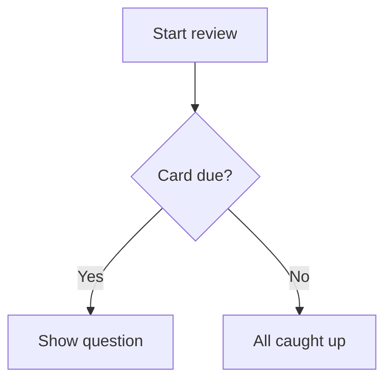

# 좋은 카드 만들기 {#writing-cards number="3"}

::: lede
카드는 질문 하나와 정답 하나예요. 나머지는 모두 선택 사항이지만, 재미는
바로 거기서 시작돼요. 평범한 텍스트 필드 아래에는 작고 친근한 마크업 언어가
숨어 있어요. 채워 넣을 빈칸, 조판된 수식, 색이 입혀진 코드, 다이어그램, 표,
그리고 원하는 그대로 소리 내어 읽히는 단어까지요.
:::

::: inthischapter
- 카드 편집기 살펴보기
- 텍스트 꾸미기, 링크 넣기, 빈칸 채우기(클로즈) 카드 만들기
- 카드에 수식, 코드, 다이어그램, 표 넣기
- 라이트 모드*와* 다크 모드 모두에서 잘 보이는 그림 추가하기
- 음성이 무엇을 말할지 알려 주기 — 그리고 힌트가 통하는 네 군데 알아보기
- 기억에 정말로 남는 카드 만들기
:::

## 카드 편집기 한눈에 보기 {#editor}

:::: split
{.phone}

::: text
모든 카드에는 **질문**과 **정답**, 두 면이 있고, 각 면은 따로 편집해요. 한
면에는 탭이 세 개 있어요.

- **텍스트** — 입력하는 내용. 위쪽에 서식 도구 막대가 있어요.
- **이미지** — 사진 앱에서 가져오거나 텍스트에 붙여 넣은 그림 한 장.
- **오디오** — `.mp3`, `.m4a`, `.wav` 같은 오디오 파일.

텍스트 필드 아래에는 [서식 도움말]{.ui}(언제든 탭 한 번으로 열리는 이 장의
휴대용 버전)과 그 면의 [언어]{.ui}가 있어요.

면은 비워 둘 수 없어요. 질문과 정답 모두 텍스트, 그림, 소리 중 하나는 있어야
[저장]{.ui}이 활성화돼요. 어느 탭에서 저장하는지도 중요해요. 텍스트와 그림,
또는 텍스트와 소리를 하나도 잃지 않고 함께 담는 방법은 4장에서 설명해요.
:::
::::

### 도구 막대

마크업을 *꼭* 외울 필요는 없어요. 텍스트 필드 위의 도구 막대가 선택한 부분을
감싸서 마크업을 대신 넣어 줘요. 도구 막대는 옆으로 스크롤되며, 왼쪽부터
순서대로 다음과 같아요.

| 버튼 | 넣는 것 |
|---|---|
| 그림 | 그 면의 이미지를 커서 위치에 |
| **B** / *I* | `**bold**` / `*italic*` |
| `</>` | `` `inline code` `` |
| *f(x)* / Σ | `$inline maths$` / `$$` 수식 블록 |
| 파형 | `[shown]{spoken}` — 음성 힌트 |
| 클로즈 | `{{c1::…}}` — 빈칸 채우기 |
| 링크 | `[label](https://…)` |
| 표 | 두 열짜리 표 |
| 다이어그램 | `mermaid` 다이어그램 블록 |
| 큰 텍스트 | `::: hero` 블록 |

### 언어가 중요해요

[언어]{.ui} 선택기는 그 면을 어떤 음성으로 읽을지 JustFlip!에 알려 줘요. 각
면마다 언어를 따로 정할 수 있어요. 예를 들어 앞면에는 스페인어 단어, 뒷면에는
그 한국어 뜻을 넣을 수 있죠.

::: gotcha
#### 언어가 없으면 음성도 없어요

새 카드는 언어가 **없음**으로 설정된 상태로 시작하고, 언어가 없는 면은 그냥
*읽히지 않아요*. 스피커 버튼으로도, 카드 읽어주기로도요. 카드에서 소리가 나지
않으면 먼저 언어를 확인하세요.
:::

### 태그와 플래그

태그는 칩 입력란에 입력해요. Return 키, **+** 버튼, 또는 쉼표를 누르면 입력한
텍스트가 태그가 돼요. `동사, 불규칙, A2`를 붙여 넣으면 칩 세 개가 한 번에
생겨요. 대소문자는 구분하지 않고, 중복된 태그는 빠져요. 색상 플래그를 달면 덱을
둘러볼 때 그 카드가 눈에 띄어요.

## 제대로 보이는 텍스트 {#text}

카드 텍스트는 작은 화면에 맞게 단순화한 Markdown이에요. 일반 텍스트의 모양을
바꾸는 방법은 다음이 전부예요.

:::: pair
```markdown
미토콘드리아는 *세포*의
**발전소**예요. 이 함수는
`atp_synthase()`예요.
```

::: {.card side="answer"}
미토콘드리아는 *세포*의 **발전소**예요. 이 함수는
`atp_synthase()`예요.
:::
::::

- `**bold**`와 `*italic*` — 강조.
- `` `code` `` — 고정폭 글꼴로 표시되는 짧은 코드.
- `\*` — 백슬래시를 붙이면 다음 문자가 그대로 표시돼요. 그래서 `\*not
  italic\*`은 별표가 그대로 남아요.
- **빈 줄**은 새 문단을 시작해요. 한 번의 줄바꿈은 그대로 유지돼요.

::: note
#### 일부러 뺀 것들

카드는 작기 때문에 몇 가지 Markdown 습관은 적용되지 않아요. `# `로 시작하는
줄은 일반 텍스트로 표시돼요. 샵 기호는 사라지고, 카드에는 제목이 없어요. `-`나
`1.` 같은 목록 기호는 입력한 그대로 표시되는데, 대개는 그게 원하는 모습일
거예요.
:::

### 링크

`[the guide](https://example.com)`은 *the guide*를 탭할 수 있는 링크로
보여 줘요. 웹(`https://`), 이메일(`mailto:`), 전화(`tel:`) 링크를 쓸 수 있고,
다른 종류의 링크는 일반 텍스트로 표시돼요.

## 빈칸 채우기 {#cloze}

**클로즈** 카드는 문장의 일부를 가려요. 질문에는 빈칸이 보이고, 카드를
뒤집으면 빠진 단어가 강조 표시된 채로 드러나요. 노트 한 문단을 테스트할 수 있는
형태로 바꾸는 가장 빠른 방법이에요.

:::: pair
```markdown
프랑스의 수도는
{{c1::파리}}예요.
```

::: {.card side="question"}
프랑스의 수도는 [[…]]{.blank}예요.
:::
::::

두 번째 콜론 쌍 뒤에 **힌트**를 붙일 수 있어요. 힌트는 빈칸 안에 표시되고,
음성은 "빈칸"이라는 말 대신 힌트를 읽어요.

:::: pair
```markdown
{{c1::미토콘드리아::세포 소기관}}는
세포 ATP의 대부분을 만들어요.
```

::: {.card side="question"}
[[세포 소기관]]{.blank}는 세포 ATP의 대부분을 만들어요.
:::
::::

카드를 뒤집으면 문장 전체가 정답이 표시된 채로 다시 나타나요.
[미토콘드리아]{.reveal}는 세포 ATP의 대부분을 만들어요. 클로즈 카드의 정답
면은 선택 사항이에요. 정답 면에 쓴 내용은 드러난 문장 아래에 추가 메모로
표시돼요.

::: gotcha
#### 한 카드의 빈칸은 모두 함께 가려져요

빈칸에 `c1`, `c2`, `c3`…처럼 번호를 붙일 수 있지만, JustFlip!에서는 한 카드의
모든 빈칸이 *동시에* 가려지고 드러나며, 카드는 하나의 항목으로 복습돼요. 빈칸
하나하나를 따로 테스트받고 싶다면 빈칸마다 카드를 한 장씩 만드세요.

Anki 사용자라면 다른 방식에 익숙할 거예요. Anki에서는 번호마다 별도의 카드가
돼요. Anki 클로즈 노트를 **가져올** 때가 바로 그래요. 노트가 번호별로 카드 한
장씩 나뉘기 때문에, Anki에서 공부한 내용은 하나도 사라지지 않아요.
:::

고민을 덜어 줄 몇 가지 세부 사항:

- 형식이 올바른 빈칸만 인식돼요. `{{c0::x}}`, `{{c1::}}`, `{{not a cloze}}`는
  중괄호까지 그대로 표시돼요.
- 중괄호 자체를 보여 주고 싶다면 `\{\{c1::…}}`라고 쓰세요.
- 코드와 수식 안의 `{{c1::…}}`는 건드리지 않고 그대로 표시돼요.

## 크게, 가운데로 {#display}

글자 하나로 된 카드도 있어요. 가나, 한자, 원소 기호, 코드 이름 같은 것들이죠.
**hero** 블록 안에 넣으면 카드를 가득 채워요.

:::: pair
```markdown
::: hero
あ
:::
```

::: {.card side="question" .hero}
あ
:::
::::

`::: center`는 크기는 바꾸지 않고 같은 일을 해요. 내용이 가운데로 정렬될
뿐이에요. 블록은 한 줄에 `::: hero`나 `::: center`만 써서 열고, `:::`로
닫으세요.

::: tip
#### 크기 자체가 강조예요

메모는 블록 *바깥에* 두어 일반 텍스트로 남기고, hero 블록 안에서는 굵게나
기울임꼴을 쓰지 마세요. 그 정도 크기에서는 오히려 산만해질 뿐이에요.
:::

## 수식 {#maths}

JustFlip!은 전 세계 수학자들이 쓰는 표기법인 TeX 문법으로 수식을 조판해요.
수식을 달러 기호 하나씩으로 감싸면 문장 안에 들어가고, `$$` 줄 사이에 넣으면
가운데 정렬된 별도의 줄로 표시돼요.

:::: pair
```markdown
도함수:

$$
f'(x) = \lim_{h\to 0}\frac{f(x+h)-f(x)}{h}
$$
```

::: {.card side="answer"}
도함수:

$$f'(x) = \lim_{h\to 0}\frac{f(x+h)-f(x)}{h}$$
:::
::::

{.shot width=78%}

인라인 수식도 같은 방식으로 작동해요. `$E = mc^2$`는 문장 안에서 바로
$E = mc^2$가 돼요. 수식을 소리 내어 읽을 때 *제대로 들리게* 하는 방법은
[음성이 무엇을 말할지 알려 주기](#speech)에서 다뤄요.

## 코드 {#code}

코드는 백틱 세 개로 감싸고, 여는 백틱 뒤에 언어 이름을 쓰세요. JustFlip!은
키워드, 문자열, 주석, 숫자, 타입에 색을 입혀요.

:::: pair
````markdown
```swift
let answer = 6 * 7
// prints 42
print(answer)
```
````

::: {.card side="answer"}
```swift
let answer = 6 * 7
// prints 42
print(answer)
```
:::
::::

인식하는 언어 이름: Swift, Python, JavaScript, TypeScript, Java, Kotlin, C,
C++, C#, Objective-C, Go, Rust, Ruby, PHP, SQL, Bash, Smalltalk/Pharo, JSON,
YAML. 알 수 없는 이름이거나 이름이 없어도 깔끔한 고정폭 블록으로 표시돼요.
색만 없을 뿐이에요. 코드 블록 안의 텍스트는 쓴 그대로 표시되고, 어떤 마크업도
적용되지 않아요.

## 다이어그램 {#diagrams}

이름이 `mermaid`인 코드 블록은 코드로 표시되지 않아요. JustFlip!이 그림으로
그려 줘요. 순서도, 시퀀스, 상태, 클래스, 개체-관계 다이어그램을 모두 지원해요.

:::: pair
````markdown

````

{.card-shot}
::::

::: tip
#### 카드 크기에 맞는 다이어그램

상자는 여덟 개 정도, 레이블은 짧게 하는 게 좋아요. `graph TD`(위에서
아래로)로 시작하세요. 카드에 더 잘 맞으면 JustFlip!이 순서도를 옆으로 눕혀
그리기도 해요. 세부 사항을 보려면 **확대** 버튼으로 다이어그램을 전체 화면으로
여세요.
:::

## 표 {#tables}

간단한 비교는 표로 보여 주는 게 가장 읽기 쉬워요. 표 위에 빈 줄을 하나 두세요.
첫 행은 머리글이며 굵게 표시돼요.

:::: pair
```markdown
| 시제 | 형태 |
|---|---|
| 현재 | I go |
| 과거 | I went |
| 현재완료 | I have gone |
```

::: {.card side="answer"}
| 시제 | 형태 |
|---|---|
| 현재 | I go |
| 과거 | I went |
| 현재완료 | I have gone |
:::
::::

셀에는 카드의 다른 부분과 같은 서식(굵게, 코드, 수식)을 쓸 수 있어요. 셀 안에
`|`를 표시하려면 `\|`라고 쓰세요.

::: gotcha
#### 두 열, 다섯 행

카드의 표는 머리글을 포함해 최대 **2열 5행**까지예요. 그 이상은 빠지고 말줄임표로
표시돼요. `|:---|---:|` 같은 정렬용 콜론은 받아들이지만, 열은 항상 왼쪽
정렬돼요. 표가 더 크다면 대개 그 카드를 여러 장으로 나누라는 신호예요.
:::

## 그림 {#pictures}

카드의 각 면에는 **그림 한 장**을 넣을 수 있어요. 이미지 탭에서 추가하거나,
텍스트 도구 막대의 그림 버튼으로 추가하세요. 그림 버튼은 텍스트에 표시자도
함께 넣어 줘요.

```markdown
Which bird is this?

![attachment:0]
```

표시자 `![attachment:0]`은 텍스트 사이에서 그림이 *어디에* 놓일지 정해요.
그림이 없는 표시자는 아무것도 보여 주지 않아요.

그림에는 **설명** 필드도 있어요. VoiceOver가 이미지를 볼 수 없는 사람에게
설명을 읽어 주므로, 몇 단어라도 적어 두면 좋아요.

::: gotcha
#### 투명한 그림은 다크 모드에서 사라져요

카드는 그림 뒤에 배경을 깔지 않고 그림을 있는 그대로 그려요. 투명한 배경 위의
검은 선은 밝은 카드에서는 완벽해 보이지만 어두운 카드에서는 완전히 사라져요.
다이어그램, 악보·기호, 선화는 추가하기 전에 불투명한 흰색 배경을 넣어 주세요.
:::

사진과 비트맵(PNG, JPEG)을 사용하세요. SVG 파일은 지원하지 않아요. 큰 사진을
미리 줄일 필요는 없어요. 저장할 때 JustFlip!이 긴 쪽 기준 3,000픽셀로 그림을
줄여서, 모든 기기에서 iCloud 동기화가 빠르게 유지돼요. 잘 보이는 그림에 대해서는
4장에서 더 다뤄요.

## 음성이 무엇을 말할지 알려 주기 {#speech}

JustFlip!은 그 면의 언어에 맞는 음성으로 어떤 카드든 소리 내어 읽을 수 있어요.
대개는 제대로 읽지만, 약어나 기호, 수식처럼 그렇지 않을 때도 있어요. 그럴 땐
**음성 힌트**를 줄 수 있어요. 무언가 바로 뒤에 중괄호를 붙이면, 음성이 그 대신
*이것*을 읽어요.

:::: pair
```markdown
[iOS]{아이오에스}
백그라운드 새로 고침을 켜세요.
```

::: {.card side="question" spoken="아이오에스 백그라운드 새로 고침을 켜세요."}
iOS 백그라운드 새로 고침을 켜세요.
:::
::::

카드에는 여전히 *iOS*가 표시되고, 음성은 "아이오에스"라고 읽어요. 이 규칙은
정확히 네 군데에서 통해요.

| 위치 | 쓰는 방법 |
|---|---|
| 일반 텍스트, 대괄호 안 | `[C♯ 단조]{씨 샵 단조}` |
| 인라인 수식 | `$c^2${c 제곱}` |
| 수식 블록 — 닫는 `$$` 뒤 | `$${V는 S 곱하기 p 곱하기 v}` |
| 그림 | `![attachment:0]{빨간 사과}` |

힌트가 없으면 텍스트는 평소대로 읽히고, 수식은 원본 그대로 읽히며, 그림은
읽히지 않아요.

::: gotcha
#### 다른 곳 뒤의 중괄호는 그대로 보여요

힌트는 이 네 군데에서만 작동해요. 굵게, 기울임꼴, 또는 그냥 텍스트 뒤에 붙인
중괄호는 카드에 그대로 표시돼요.

- `*F♯ 장조*{에프 샵 장조}` → 카드에 *F♯ 장조*{에프 샵 장조}라고 표시돼요
- `*[F♯ 장조]{에프 샵 장조}*` → 카드에는 *F♯ 장조*가 표시되고, 음성은
  "에프 샵 장조"라고 읽어요

헷갈릴 때는 대괄호를 쓰세요. 서식은 대괄호 *바깥에* 두세요.
:::

::: tip
#### 음성이 틀리게 읽는 것에만 힌트를

힌트는 음악의 샵과 플랫, 수식, 약어, 로마자로 표기한 음절처럼 텍스트 음성
변환이 자주 틀리는 것에 쓰세요. 이미 쓰여 있는 그대로를 반복할 필요는 없어요.
그리고 전반적으로 더 좋은 음성을 원한다면, 시스템 설정의 **손쉬운 사용 ›
읽기 및 말하기 › 음성**에서 향상된 음성이나 프리미엄 음성을 다운로드한 다음,
JustFlip!의 **설정 › 음성 › 음성**에서 선택하세요.
:::

## 카드가 너무 길 때 {#fitting}

JustFlip!은 먼저 모든 내용을 카드에 맞춰 넣으려고 해요. 텍스트가 들어가지
않으면 글자를 조금씩 줄이는데, 보통 크기의 80 %까지 줄여요. 그래도 들어가지
않으면 마지막으로 온전히 들어가는 줄에서 텍스트를 자르고, 카드 아래쪽이
흐려지며 사라지게 표시해요.

그래도 잃어버리는 건 없어요. 카드 아래쪽의 **•••** 버튼을 누르면 그 면의 전체
내용이 시트로 열려요. 다이어그램이나 그림이 들어가는 카드에서는 같은 자리에
**확대** 버튼이 대신 있어서, 그림을 전체 화면으로 열어 줘요.

이건 안전망일 뿐, 카드를 쓰는 방식이 아니에요. 한눈에 읽을 수 없는 카드는 대개
두세 장의 카드가 한 장인 척하고 있는 거예요.

## 기억에 남는 카드 {#good-cards}

서식은 카드를 보기 좋게 만들어요. 이런 습관은 카드가 *제대로 작동하게*
만들어요.

1. **카드 한 장에 사실 하나.** "삼권 분립의 세 기관은 무엇인가요?"는 절반은
   틀리게 되는 카드 한 장이에요. 기관마다 한 장씩, 세 장으로 나누면 각각
   제대로 기억할 수 있어요.
2. **정확하게 물어보세요.** 정답이 두 개일 수 있는 질문은 어느 쪽도 가르쳐
   주지 못해요. 답이 하나만 맞을 때까지 맥락이나 클로즈 힌트를 더하세요.
3. **자기 말로 쓰세요.** 무언가를 바꿔 말하는 것이 첫 번째 반복이고, 그건 공짜예요.
4. **그림이나 소리를 더하세요.** 대상 자체가 눈으로 보거나 귀로 듣는 것일
   때는요. 새, 화음, 발음 같은 것들이요.
5. **한 덱 안에서는 질문 텍스트가 겹치지 않게 하세요.**

::: gotcha
#### 카드 두 장, 질문 하나

덱 파일을 가져올 때(5장), 질문 텍스트가 그 덱에 이미 있는 카드와 똑같은 카드는
새 카드로 추가되지 않고 기존 카드를 *업데이트*해요. 덕분에 덱을 다시 가져와도
안전해요. 하지만 이는 질문 텍스트가 완전히 같은 두 카드(예: "이 음의 이름은?")가
한 장으로 합쳐진다는 뜻이기도 해요. 공통된 질문은 덱 이름에 넣거나, 그림만 있는
카드라면 질문 텍스트를 비워 두세요.
:::

## 요약표 {#cheat-sheet .cheatsheet}

| 이렇게 쓰면 | 이렇게 돼요 |
|---|---|
| `**bold**` · `*italic*` | **굵게** · *기울임꼴* |
| `` `code` `` | 고정폭 코드 조각 |
| `\*` | 문자 그대로의 `*` |
| `[label](https://…)` | 링크(`https`, `mailto`, `tel`) |
| `{{c1::answer}}` | 뒤집으면 드러나는 빈칸 |
| `{{c1::answer::hint}}` | 힌트가 보이는 빈칸 |
| `::: hero` … `:::` | 아주 크게, 가운데 정렬된 내용 |
| `::: center` … `:::` | 가운데 정렬된 내용 |
| `$x^2$` | 인라인 수식 |
| `$$` … `$$` | 가운데 정렬된 수식 블록 |
| ```` ```swift ```` … ```` ``` ```` | 색이 입혀진 코드 |
| ```` ```mermaid ```` … ```` ``` ```` | 다이어그램 |
| `| A | B |` + `|---|---|` | 표, 최대 2 × 5 |
| `![attachment:0]` | 그 면의 그림을 이 위치에 |
| `[shown]{spoken}` | 다른 말로 소리 내어 읽기 |
| `$x^2${x squared}` | 음성으로 읽히는 수식 |
| `![attachment:0]{a red apple}` | 음성으로 읽히는 그림 |
