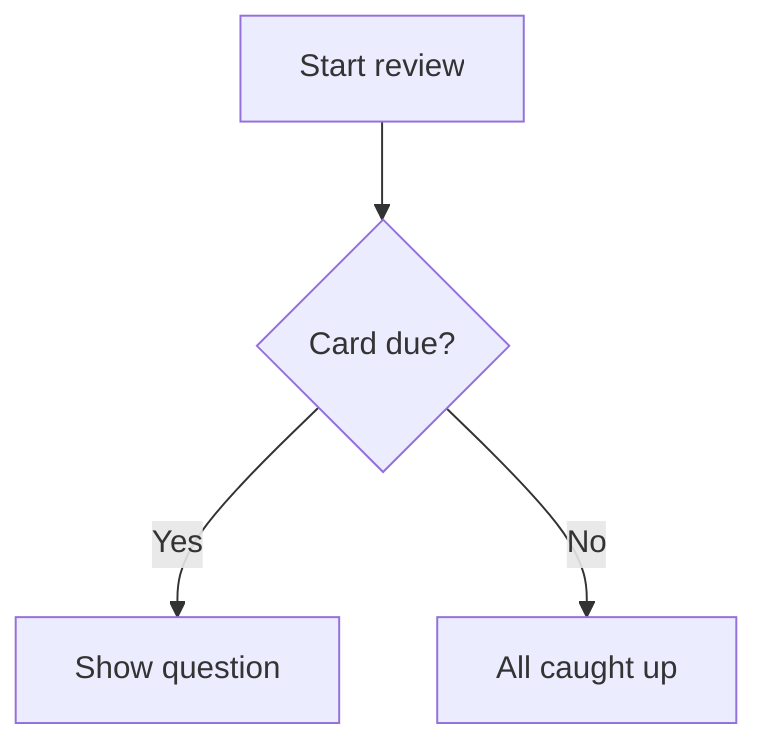

# Escrevendo ótimos cartões {#writing-cards number="3"}

::: lede
Um cartão é uma pergunta e uma resposta. Todo o resto é opcional — e é aí
que começa a diversão. Por trás do simples campo de texto há uma pequena
linguagem de marcação, fácil de usar: lacunas para preencher, matemática
bem composta, código com destaque de sintaxe, diagramas, tabelas e
palavras lidas em voz alta exatamente do jeito que você quer.
:::

::: inthischapter
- Oriente-se pelo editor de cartões
- Formate o texto, adicione links e crie cartões com lacunas (cloze)
- Coloque matemática, código, diagramas e tabelas num cartão
- Adicione imagens que ficam bonitas no modo claro *e* no escuro
- Diga à voz o que falar — e conheça os quatro lugares em que ela escuta
- Escreva cartões que a sua memória vai realmente guardar
:::

## O editor de cartões num relance {#editor}

:::: split
{.phone}

::: text
Todo cartão tem dois lados, **Pergunta** e **Resposta**, e cada lado é
editado separadamente. Um lado tem três abas:

- **Texto** — o que você digita, com a barra de formatação acima.
- **Imagem** — uma imagem do app Fotos (ou colada no texto).
- **Áudio** — um arquivo de áudio, como `.mp3`, `.m4a` ou `.wav`.

Abaixo do campo de texto ficam a [Ajuda de formatação]{.ui} — uma versão
de bolso deste capítulo, sempre a um toque de distância — e o
[Idioma]{.ui} do lado.

Um lado não pode ficar vazio: tanto a pergunta quanto a resposta precisam
de texto, imagem ou som antes que [Salvar]{.ui} fique disponível. A aba
de onde você salva também importa — o Capítulo 4 explica como combinar
texto com imagem ou som sem perder nenhum dos dois.
:::
::::

### A barra de ferramentas

Você nunca *precisa* decorar a marcação. A barra acima do campo de texto
a insere para você, em volta do que estiver selecionado. Ela rola para os
lados; da esquerda para a direita:

| Botão | Insere |
|---|---|
| Imagem | a imagem do lado, na posição do cursor |
| **B** / *I* | `**negrito**` / `*itálico*` |
| `</>` | `` `código inline` `` |
| *f(x)* / Σ | `$matemática inline$` / um bloco de matemática `$$` |
| Forma de onda | `[exibido]{falado}` — uma dica falada |
| Lacuna | `{{c1::…}}` — uma lacuna para preencher |
| Link | `[rótulo](https://…)` |
| Tabela | uma tabela de duas colunas |
| Diagrama | um bloco de diagrama `mermaid` |
| Texto grande | um bloco `::: hero` |

### O idioma importa

O seletor de [Idioma]{.ui} diz ao JustFlip! qual voz deve ler aquele lado
em voz alta, e cada lado tem o seu — uma palavra em espanhol na frente, o
significado em português no verso.

::: gotcha
#### Sem idioma, sem voz

Um cartão novo começa com o idioma definido como **Nenhum**, e um lado
sem idioma simplesmente *não é falado* — nem pelo botão de alto-falante,
nem por Ler cartões. Se um cartão ficar em silêncio, confira primeiro o
idioma dele.
:::

### Tags e marcadores

As tags são digitadas num campo de etiquetas: pressione Return, o botão
**+** ou uma vírgula para transformar o texto numa tag. Cole
`verbos, irregulares, A2` e você ganha três tags de uma vez. Maiúsculas e
minúsculas não importam, e as duplicadas são descartadas. Um marcador
colorido faz um cartão se destacar quando você percorre um baralho.

## Texto com a aparência certa {#text}

O texto do cartão é Markdown, simplificado para telas pequenas. Aqui está
tudo o que dá forma ao texto simples:

:::: pair
```markdown
As mitocôndrias são a **usina**
da *célula*. A função é
`atp_synthase()`.
```

::: {.card side="answer"}
As mitocôndrias são a **usina** da *célula*. A função é
`atp_synthase()`.
:::
::::

- `**negrito**` e `*itálico*` — ênfase.
- `` `código` `` — um trecho em fonte monoespaçada.
- `\*` — uma barra invertida mostra o caractere seguinte literalmente,
  então `\*sem itálico\*` mantém os asteriscos.
- Uma **linha em branco** começa um novo parágrafo; uma quebra de linha
  simples é mantida como está.

::: note
#### O que ficou de fora de propósito

Os cartões são pequenos, então alguns hábitos do Markdown não se aplicam.
Uma linha que começa com `# ` aparece como texto simples — os sinais de
cerquilha são removidos, não há títulos num cartão. Marcadores de lista
como `-` ou `1.` aparecem exatamente como você os digitou, que em geral é
o que você quer mesmo.
:::

### Links

`[o guia](https://example.com)` mostra *o guia* como um link tocável.
Links da web (`https://`), de e-mail (`mailto:`) e de telefone (`tel:`)
funcionam; qualquer outro tipo de link aparece como texto simples.

## Preencha as lacunas {#cloze}

Um cartão **cloze** esconde parte de uma frase. A pergunta mostra uma
lacuna; virar o cartão revela as palavras que faltam, em destaque. É o
jeito mais rápido de transformar um parágrafo de anotações em algo sobre
o que você pode ser testado.

:::: pair
```markdown
A capital da França
é {{c1::Paris}}.
```

::: {.card side="question"}
A capital da França é [[…]]{.blank}.
:::
::::

Adicione uma **dica** depois de um segundo par de dois-pontos. A dica
aparece dentro da lacuna, e é o que a voz diz no lugar da palavra
"lacuna":

:::: pair
```markdown
{{c1::As mitocôndrias::organela}}
produzem a maior parte do ATP da célula.
```

::: {.card side="question"}
[[organela]]{.blank} produzem a maior parte do ATP da célula.
:::
::::

Quando o cartão é virado, a frase inteira volta com as respostas
marcadas — [As mitocôndrias]{.reveal} produzem a maior parte do ATP da
célula. O lado Resposta de um cartão cloze é opcional. O que você
escrever ali aparece abaixo da frase revelada, como notas extras.

::: gotcha
#### Todas as lacunas de um cartão se escondem juntas

Numere suas lacunas `c1`, `c2`, `c3`… — mas no JustFlip! todas as
lacunas de um cartão são escondidas e reveladas *ao mesmo tempo*, e o
cartão é revisado como um único item. Quer ser testado em cada lacuna
separadamente? Crie um cartão por lacuna.

Quem usa o Anki conhece o outro comportamento: lá, cada número vira um
cartão próprio. É exatamente o que acontece quando você **importa** uma
nota cloze do Anki — ela é dividida em um cartão por número, então nada
do que você estudou no Anki se perde.
:::

Alguns detalhes que poupam dor de cabeça:

- Só lacunas bem formadas contam. `{{c0::x}}`, `{{c1::}}` ou
  `{{não é cloze}}` aparecem literalmente, com chaves e tudo.
- Precisa das próprias chaves? Escreva `\{\{c1::…}}`.
- Dentro de código e de matemática, `{{c1::…}}` fica intocado — continua
  literal.

## Grande e centralizado {#display}

Alguns cartões são um único caractere: um kana, um kanji, um símbolo
químico, o nome de um acorde. Coloque-o dentro de um bloco **hero** e ele
preenche o cartão:

:::: pair
```markdown
::: hero
あ
:::
```

::: {.card side="question" .hero}
あ
:::
::::

`::: center` faz o mesmo sem mudar o tamanho — o conteúdo é simplesmente
centralizado. Abra o bloco com `::: hero` ou `::: center` numa linha
própria e feche-o com `:::`.

::: tip
#### Deixe o tamanho ser a ênfase

Mantenha as notas *fora* do bloco, para que continuem como texto normal,
e dispense negrito ou itálico dentro de um bloco hero. Nesse tamanho,
eles só atrapalham.
:::

## Matemática {#maths}

O JustFlip! compõe matemática com a sintaxe TeX, a notação usada por
matemáticos do mundo todo. Envolva uma fórmula em cifrões simples para
mantê-la na linha, ou coloque-a entre linhas `$$` para dar a ela uma
linha própria, centralizada:

:::: pair
```markdown
A derivada:

$$
f'(x) = \lim_{h\to 0}\frac{f(x+h)-f(x)}{h}
$$
```

::: {.card side="answer"}
A derivada:

$$f'(x) = \lim_{h\to 0}\frac{f(x+h)-f(x)}{h}$$
:::
::::

{.shot width=78%}

A matemática inline funciona do mesmo jeito: `$E = mc^2$` vira
$E = mc^2$ bem no meio da frase. Como fazer uma fórmula *soar* certa ao
ser lida em voz alta você vê em [Diga à voz o que falar](#speech).

## Código {#code}

Delimite o código com três crases e escreva o nome da linguagem logo
depois da abertura. O JustFlip! colore palavras-chave, strings,
comentários, números e tipos:

:::: pair
````markdown
```swift
let answer = 6 * 7
// prints 42
print(answer)
```
````

::: {.card side="answer"}
```swift
let answer = 6 * 7
// prints 42
print(answer)
```
:::
::::

Nomes de linguagem reconhecidos: Swift, Python, JavaScript, TypeScript,
Java, Kotlin, C, C++, C#, Objective-C, Go, Rust, Ruby, PHP, SQL, Bash,
Smalltalk/Pharo, JSON e YAML. Um nome desconhecido ou ausente ainda gera
um bloco limpo em fonte monoespaçada — só que sem cores. O texto dentro
de um bloco de código aparece exatamente como foi escrito; nenhuma
marcação é aplicada ali.

## Diagramas {#diagrams}

Um bloco de código chamado `mermaid` nem aparece como código — o
JustFlip! o desenha. Fluxogramas e diagramas de sequência, de estados, de
classes e de entidade-relacionamento são todos suportados.

:::: pair
````markdown

````

{.card-shot}
::::

::: tip
#### Diagramas do tamanho de um cartão

Mire em umas oito caixas com rótulos curtos. Comece com `graph TD`
(de cima para baixo); o JustFlip! pode deitar um fluxograma quando isso
couber melhor no cartão. Para ver os detalhes, o botão **Ampliar** abre o
diagrama em tela cheia.
:::

## Tabelas {#tables}

Comparações pequenas ficam melhores numa tabela. Deixe uma linha em
branco antes dela; a primeira linha é o cabeçalho e aparece em negrito:

:::: pair
```markdown
| Tempo | Forma |
|---|---|
| Presente | I go |
| Passado | I went |
| Perfeito | I have gone |
```

::: {.card side="answer"}
| Tempo | Forma |
|---|---|
| Presente | I go |
| Passado | I went |
| Perfeito | I have gone |
:::
::::

As células aceitam a mesma formatação do resto do cartão — negrito,
código, matemática. Para mostrar um `|` dentro de uma célula, escreva
`\|`.

::: gotcha
#### Duas colunas, cinco linhas

Uma tabela de cartão tem no máximo **2 colunas e 5 linhas**, contando o
cabeçalho. O que passar disso fica de fora e é marcado com reticências.
Os dois-pontos de alinhamento, como `|:---|---:|`, são aceitos, mas as
colunas são sempre alinhadas à esquerda. Uma tabela maior costuma ser
sinal de que o cartão quer virar vários cartões.
:::

## Imagens {#pictures}

Cada lado de um cartão tem **uma imagem**. Adicione-a na aba Imagem ou
com o botão de imagem na barra de texto, que também insere um marcador
no texto:

```markdown
Que pássaro é este?

![attachment:0]
```

O marcador, `![attachment:0]`, decide *onde* a imagem fica no meio do
texto. Um marcador sem imagem por trás simplesmente não mostra nada.

A imagem também tem um campo de **descrição**. O VoiceOver o lê para
quem não consegue ver a imagem, então vale a pena escrever algumas
palavras.

::: gotcha
#### Imagens transparentes somem no modo escuro

O cartão desenha a sua imagem exatamente como ela é, sem nenhum fundo
por trás. Linhas pretas sobre fundo transparente ficam perfeitas num
cartão claro e desaparecem por completo num cartão escuro. Dê um fundo
branco sólido a diagramas, notações e desenhos de linha antes de
adicioná-los.
:::

Use fotos e bitmaps (PNG, JPEG). Arquivos SVG não são suportados. Não é
preciso reduzir fotos grandes antes: ao salvar, o JustFlip! reduz a
imagem para 3.000 pixels no lado maior, o que mantém a sincronização com
o iCloud rápida em todos os seus dispositivos. O Capítulo 4 fala mais
sobre imagens que funcionam bem.

## Diga à voz o que falar {#speech}

O JustFlip! pode ler qualquer cartão em voz alta, com a voz do idioma
daquele lado. Geralmente ele acerta. Quando não acerta — uma sigla, um
símbolo, uma fórmula —, você pode dar a ele uma **dica falada**: chaves
logo depois de algo dizem à voz para falar *isto* no lugar.

:::: pair
```markdown
Ative a atualização em segundo
plano do [iOS]{ai ó és}.
```

::: {.card side="question" spoken="Ative a atualização em segundo plano do ai ó és."}
Ative a atualização em segundo plano do iOS.
:::
::::

O cartão continua mostrando *iOS*; a voz diz "ai ó és". A mesma regra
funciona em exatamente quatro lugares:

| Onde | Você escreve |
|---|---|
| Qualquer texto, entre colchetes | `[C♯ menor]{dó sustenido menor}` |
| Matemática inline | `$c^2${c ao quadrado}` |
| Um bloco de matemática — depois do `$$` de fechamento | `$${V igual a S p v}` |
| Uma imagem | `![attachment:0]{uma maçã vermelha}` |

Sem dica, o texto é lido normalmente, a matemática é lida a partir do
código-fonte e as imagens ficam em silêncio.

::: gotcha
#### Chaves depois de qualquer outra coisa aparecem no cartão

Uma dica só funciona nesses quatro lugares. Depois de negrito, itálico ou
texto solto, as chaves aparecem no cartão:

- `*F♯ maior*{fá sustenido maior}` → o cartão mostra *F♯ maior*{fá sustenido maior}
- `*[F♯ maior]{fá sustenido maior}*` → o cartão mostra *F♯ maior* e a
  voz diz "fá sustenido maior"

Na dúvida, use colchetes. Coloque qualquer formatação *fora* deles.
:::

::: tip
#### Dicas para o que a voz erra

As dicas servem para sustenidos e bemóis, fórmulas, abreviações e sílabas
romanizadas — coisas em que a síntese de voz tropeça. Não precisa repetir
o que já está escrito. E, para vozes melhores no geral, baixe uma voz
Aprimorada ou Premium nos ajustes do sistema, em **Acessibilidade ›
Leitura e Fala › Vozes**, e depois escolha-a no JustFlip! em **Ajustes ›
Fala › Vozes**.
:::

## Quando um cartão é longo demais {#fitting}

O JustFlip! primeiro tenta fazer tudo caber no cartão. Se o texto não
couber, ele diminui um pouco, até 80 % do tamanho normal. Se ainda assim
não couber, o texto é cortado na última linha inteira e a parte de baixo
do cartão vai sumindo num degradê.

Mas nada se perde. O botão **•••** na parte de baixo de um cartão abre o
conteúdo completo daquele lado numa folha. Num cartão cujo diagrama ou
imagem cabe, o mesmo lugar mostra **Ampliar**, que abre a imagem em tela
cheia.

Isso é uma rede de segurança, não um estilo de escrita. Um cartão que
você não consegue ler num relance geralmente são dois ou três cartões
fingindo ser um só.

## Cartões que a sua memória vai guardar {#good-cards}

A formatação deixa um cartão agradável. Estes hábitos o fazem
*funcionar*:

1. **Um fato por cartão.** "Quais são os três poderes do governo?" é um
   cartão que falha metade das vezes. Três cartões, um por poder,
   funcionam cada um por si.
2. **Pergunte com precisão.** Uma pergunta que admite duas respostas
   certas não ensina nenhuma. Acrescente contexto — ou uma dica de
   lacuna — até que só uma resposta sirva.
3. **Use suas próprias palavras.** Reformular algo já é a primeira
   repetição, e sai de graça.
4. **Adicione uma imagem ou um som** sempre que a coisa *for* visual ou
   sonora: um pássaro, um acorde, uma pronúncia.
5. **Mantenha os textos das perguntas únicos dentro de um baralho.**

::: gotcha
#### Dois cartões, uma pergunta

Quando você importa um arquivo de baralho (Capítulo 5), um cartão cujo
texto de pergunta é igual ao de um cartão que já está naquele baralho
*atualiza* esse cartão em vez de adicionar um novo. Isso torna seguro
reimportar um baralho. Mas também significa que dois cartões com
exatamente o mesmo texto de pergunta — "Que nota é esta?", por exemplo —
viram um cartão só. Coloque o enunciado comum no nome do baralho, ou
deixe o texto da pergunta vazio nos cartões que têm só imagem.
:::

## Guia rápido {#cheat-sheet .cheatsheet}

| Você escreve | Você obtém |
|---|---|
| `**negrito**` · `*itálico*` | **negrito** · *itálico* |
| `` `código` `` | trecho em fonte monoespaçada |
| `\*` | um `*` literal |
| `[rótulo](https://…)` | um link (`https`, `mailto`, `tel`) |
| `{{c1::resposta}}` | uma lacuna, revelada ao virar |
| `{{c1::resposta::dica}}` | uma lacuna que mostra uma dica |
| `::: hero` … `:::` | conteúdo bem grande, centralizado |
| `::: center` … `:::` | conteúdo centralizado |
| `$x^2$` | matemática inline |
| `$$` … `$$` | um bloco de matemática centralizado |
| ```` ```swift ```` … ```` ``` ```` | código com destaque de sintaxe |
| ```` ```mermaid ```` … ```` ``` ```` | um diagrama |
| `| A | B |` + `|---|---|` | uma tabela, no máximo 2 × 5 |
| `![attachment:0]` | a imagem do lado, aqui |
| `[exibido]{falado}` | dizer outra coisa em voz alta |
| `$x^2${x ao quadrado}` | uma fórmula falada |
| `![attachment:0]{uma maçã vermelha}` | uma imagem falada |
